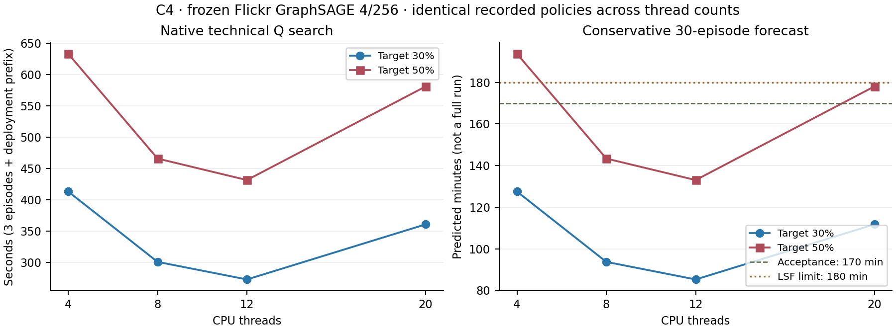

# Verified C4 CPU thread-scaling results

Collected2November2026. **All8 technical profiles COMPLETED and independently
verified: PASS8 / FAIL0 / SKIPPED0.** No new training, Q search, pruning experiment,
CUDA execution or full56 submission during collection. Original submission and
historical campaign evidence remain unchanged; this is a new provenance group.

**Recommend12 CPU threads for the two GraphSAGE4/256 Q conditions**, reproducing
the tested C4 allocation/affinity. Their conservative worst-target30-episode
forecast is **133.05min**, below the unchanged170min acceptance threshold and
180min absolute LSF limit.8 threads also pass;20 threads fail170min acceptance.
This is a resource forecast from3 episodes, not a measured completed30-episode run.

## Native jobs and hardware

LSF1612046 finished successfully on **C4**,1November23:45:18 MSK, after starting
22:42:37 (62min41s RUN; queue waiting separate). CPU time reported by LSF:
30,752.6s; sampled MAX MEM2.6Gbytes. Eight independent Python processes ran
**serially within the same exclusive20-slot C4 job**. The1-slot topology jobs
1612044/1612045 on C2/C3 completed successfully; each exclusive reservation also
withheld20 slots, but neither executed a model or Q-learning.

Native topology on **all three C2/C3/C4 hosts**:20 physical cores,160 logical CPUs,
SMT8,2 sockets and2 NUMA nodes. [Topology table](topology.csv). All numerical
measurements below are C4 only; C2/C3 are metadata evidence, not timing comparators.

All eight workers use identical20-core affinity with one permitted SMT sibling
per core: `0,80,8,88,16,96,24,104,32,112,40,120,48,128,56,136,64,144,72,152`.
Every native thread's saved affinity matches that mask. Torch intra-op=N and
inter-op1; observed OpenBLAS/pthreads POWER8 and OpenMP pool counts are exactly
4/8/12/20 as configured. Nested OpenMP teams disabled; no concurrent policy,
multiprocessing or SMT sibling sharing in the selected mask. Default NUMA memory
policy; no memory interleaving optimization or frequency-cause claim.

## Search cost and unchanged forecast

Frozen Flickr GraphSAGE4/256 Dense checkpoint/split/policy seed101; same3 complete
Q-training episodes and at-most2-action deployment prefix per condition. The
scientific configuration remains30episodes, alpha.1/gamma.9/epsilon.2, unchanged
budget-V5 state/menu/reward/reachability/cache rules. Both targets actually measured.

| Threads | 30% search, s | 50% search, s | 30% forecast, min | 50% forecast, min | Worst-target170min gate |
|---:|---:|---:|---:|---:|---|
|4|413.192|632.835|127.53|193.73|FAIL|
|8|301.063|465.782|93.74|143.38|PASS|
|**12**|**273.026**|**431.506**|**85.29**|**133.05**|**PASS, recommended**|
|20|360.841|580.752|111.75|178.03|FAIL; below180 but above170|

Exact existing formula, recomputed independently:
`safe seconds = measured search seconds × (31/3) × 1.75 + 180`.
Thread selection uses the larger **measured** target cost, preserving a
conservative envelope instead of assuming identical30/50 runtimes.50% happened
to be slower at every N. No safety factor, threshold, episode count or accuracy
criterion was adjusted after seeing results.

At12 threads, search speedup versus matched fresh4 is **1.513× at30% and1.467×
at50%**;50% wall search falls31.8%. Worst-target margin to170min is36.95min.
New4/50 costs632.835s versus historical630.485s (+0.37%); the historical50%
scientific trace also matches exactly. Old and fresh timing are separate profiles.

The native3-episode50% profile has410 requests,401 actual forwards and9 cache hits
at every N.30% has250/245/5. Different target costs are supported by different
recorded work, not silently equated. Foreground timing includes observation
wrappers conservatively; hashing/cache overhead is separated from actual forwards.

## Uncached full-batch forwards

Two warmups plus seven measured forwards for **each** model in each fresh process;
no cache hits can serve these timings. Representative pruned weights are the
verified original static-magnitude checkpoint, widths[111,230,219],266433 physical
parameters; Dense has[256,256,256],522503parameters. It is not selected from the
new Q outcomes.

Medians below use the process profiling50%;30%-process values and all sample SDs
are in [runs.csv](runs.csv). Both processes load the same fixed forward models.

| Threads | Dense median ± sample SD, s | Pruned median ± sample SD, s | Q50 average CPU utilization | Whole-process peak RSS, GiB |
|---:|---:|---:|---:|---:|
|4|1.6100 ±0.0419|1.4080 ±0.0693|351.7%|2.705|
|8|1.1263 ±0.0112|1.0225 ±0.0095|702.1%|2.741|
|12|1.1042 ±0.0308|0.9279 ±0.0039|981.4%|2.768|
|20|1.4808 ±0.1565|1.3190 ±0.2349|1385.1%|2.806|

100% utilization means one CPU's process time per wall second; these percentages
are not percentages of the whole20-core node.12 threads use about1.90× the4-thread
CPU time for the50% search while reducing walltime.20 uses still more CPU time and
runs slower than12. No independent bandwidth/NUMA/hardware-counter experiment was
performed, so contention, scheduling/spin overhead and memory bandwidth remain
possible mechanisms, not confirmed causes.

At12/50, evaluation including cache/hash work is414.754s of431.506s (96.1%);
physical surgery4.378s, magnitude scoring/ranking12.120s, legality/state encoding
0.098s and Q updates0.008s. Inclusive step time overlaps these categories and is
never added again. Full episode times and accounting are in runs.csv/raw timing
files. Peak RSS across all8 is2.689–2.806GiB; the existing3×RSS+2GiB formula gives
10552MiB for the recommended configuration's worse target, below32768MB request.

[Uncached forward figure](figures/forward_scaling.png),
[scaling SVG](figures/thread_scaling.svg), [forward SVG](figures/forward_scaling.svg).
Q search has one profile per condition; it has no replicate-based error bar.
Forward bars show within-process sample SD, not full-search uncertainty.

## Independent scientific and artifact audit

Transferred archive SHA256:
`a317afc7e4f5d1255e010b5b6ab83387a71f43b6844ab04529bc1f5d4fc0c21f`.
All1026 files/160,173,584 bytes match the separately generated server inventory;
safe extraction rejects absolute/traversal/link/special members.876 executable
snapshot files match the original preparation manifest. Executed source10d7782,
scientific engine source1b8b8b7. Original graph/split/Dense/representative-checkpoint
pins, INTENT/ACCEPTED receipts, actual host and native output inventories verified.

The offline auditor never calls `run`, environment `step`, model fitting or policy
search. It independently reconstructs:

- **2616 training transitions**,2640 cache requests, states/retained identities,
  exact parameter geometry and continuations. Reachability enumerates two integer
  width axes and solves the third interval independently of the production lattice.
- Epsilon RNG/action/tied-max choices, reward terms and terminal handling, every
  Bellman update, final Q table, coverage and unseen-choice counts. All24 training
  episodes terminate in their target band; each has one terminal transition.
- Cache reuse and callback counts from exact tensor projections of original
  retained channels; no invented counterfactual validation scores.
- All8 strict checkpoint reloads, physical parameters, final original IDs and
  tensor projections;8 independent frozen validation forwards. Test labels stay
  masked and are never evaluated. Local verification uses Python3.12.9/Torch2.2.2/
  PyG2.6.1, separately from native Torch2.0.1 timing evidence. Validation accuracy,
  macro-F1 **and loss** reproduced exactly (maximum observed loss difference0).

For each target, **all N have exactly equal training/deployment/decision/cache
traces, Q tables, channel IDs/masks and final tensors**, with zero reward/Q
arithmetic differences and zero validation accuracy/F1 differences. Fresh4/50
also exactly matches the preserved historical native4/50 traces and tensors.
[AUDIT.json](AUDIT.json) records8 PASS/0 FAIL/0 SKIPPED; all22 focused collection/
benchmark tests PASS/0 FAIL/0 SKIPPED,6.66s. Full suite not rerun; earlier158/13
preparation test counts are preserved separately, not claimed as new tests.

These **technical deployment prefixes are not completed30%/50% scientific pruning**:

| Requested target | Final prefix widths | Parameters | Actual compression | Validation accuracy | Macro-F1 | Stop |
|---:|---|---:|---:|---:|---:|---|
|30%|244/256/256|504347|3.4748%|54.0448%|0.241036|technical_prefix|
|50%|255/255/256|519967|0.4854%|54.0280%|0.240890|technical_prefix|

Neither prefix reaches the target band; this is expected after the bounded two
actions. Do not use these metrics for architecture/policy selection or compare
them as finished30/50 compression outcomes. All8 reuse one trained checkpoint
and policy seed101; they are not eight independent trained baselines.

## Full56 disposition and limitations

**Q4/256 resource remedy: GO at12 threads under the measured C4 configuration.**
A forecast-only [56-row assessment](campaign_resource_assessment.csv) replaces
only the two blocked Q4/256 resource rows with the conservative12-thread envelope;
other54 retain their original4-thread evidence. All56 predicted costs fit170min
and32768MB under that proposal. No higher-thread speedup is imputed elsewhere.

**Full56 deployment: NOT READY / NOT SUBMITTED.** The production Flickr runner
and LSF launcher still hardcode4 threads. Collection did not alter them.
[CAMPAIGN_ASSESSMENT.json](CAMPAIGN_ASSESSMENT.json) is explicitly **not a valid
submission gate** and does not refresh old gate timestamps. Reproducing this
remedy requires separate execution-resource plumbing (12 threads, exclusive20-slot
C4 allocation, tested physical affinity/inter-op controls), pinned source and a
fresh complete campaign manifest/gate before any separately authorized launch.

One nonrandomized thread-order pass, one Dense checkpoint, one policy seed, no
full30-episode run. Seven forward repeats estimate within-process variability;
three learning episodes are different trajectories, not timing replicates.
The predeclared projection is conservative but not a hard runtime guarantee.
No algorithm, reward, stopping rule, historical result or manuscript was changed.

## Reproduction and evidence

[audit.py](audit.py) audits an already collected archive and original inputs;
[figures.py](figures.py) renders only stored CSV measurements. Exact artifact
provenance/hashes and verification commands: [PROVENANCE.json](PROVENANCE.json).
Raw archive, logs, Q traces/tables and checkpoints remain outside Git:
`${GNN_ARTIFACT_ROOT}/flickr-cpu-thread-scaling-collection-20261102T211303Z/`.
Original submission evidence remains in its original directory. No new jobs or
scientific results collection beyond this technical benchmark.
