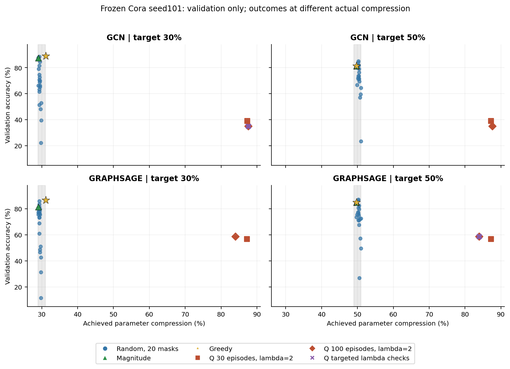
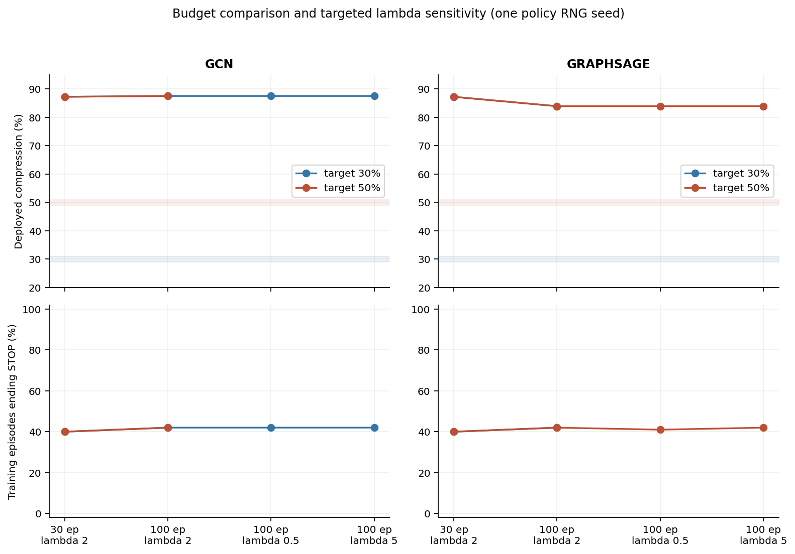
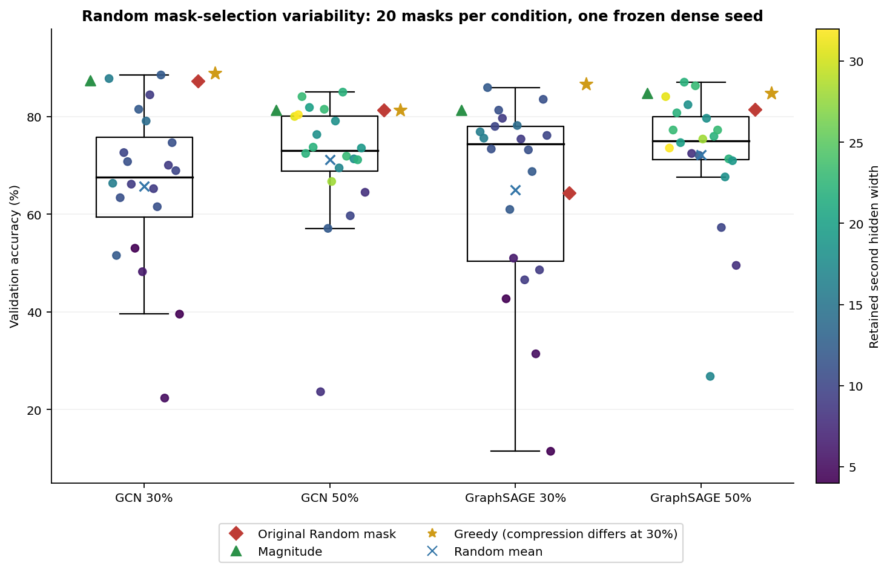

# LOCAL-STRUCTURED-V2 — validation-only Q-learning / Random pilot

2026-10-27. **Q-learning: REQUIRES ALGORITHM REVIEW. Random baseline: ADEQUATE
as a repeated-mask diagnostic baseline.** No final research hyperparameters chosen.

The old ≈18.65% Q result was a3-step diagnostic endpoint, not a stable property of
Q-learning. With max_steps20, both30 and100 episodes instead overcompress strongly.
Increasing the episode budget and targeted lambda checks do not qualify the policy
for the requested30%/50% endpoints. This is a scientific/learning qualification
finding, not a verified implementation defect; production code and R2 are unchanged.

Random's high single-mask outcomes are not representative of its mean. The four
20-mask samples show large dispersion and materially different architecture
sampling distributions at30% versus50%. No best mask is selected as the baseline.

## Scope, validity and exact inputs

- Tested core SHA: `f110c5d1c57bd34afb5ad76e17415ec09ce64e9f`, clean branch
  `implementation/local-structured-v2-20261027`. The new evidence commit changes
  documentation and standalone diagnostic scripts only, not `src/`, tests or SPEC.
- Existing Python3.12.9 / Torch2.2.2 / PyG2.6.1; local CPU, two Torch threads and
  OMP/MKL/OpenBLAS limits2. No environment created or package installed. Plotting
  uses the existing Python3.8.20 / Matplotlib3.7.5 environment to read CSVs only.
- Exactly **8 Phase A Q conditions**, **4 targeted Phase B Q conditions**, and
  **80 Random masks**. Total920 training episodes,12 deployments,92 physical
  checkpoints. No GNN training, fine-tuning, dataset download, POLUS operation,
  full multi-dataset campaign or inference latency benchmark.
- Both models: Cora, three layers, F1433→32→32→C7, dropout0.5. Same archived
  POLUS seed101 checkpoint/split for each model across all targets/settings.
  Checkpoint training seed remains101. Policy RNG seed101 is recorded separately;
  Random mask RNG seeds1000–1019 never replace checkpoint identity/run.seed.
- Standalone runner calls the **unchanged production** `run_q_learning` and
  Random `plan_static(..., criterion='random', seed=mask_seed)` / `apply_static_plan`.
  It replaces **all labels outside validation with−1**, including train labels;
  neither pilot scoring, policy decisions nor any pilot reporting can access test
  labels. No test metric is generated, copied into pilot tables/plots, or selected.
- Q observer wrappers call original reset/select/update exactly once. They only
  copy Q rows/state/IDs and clone RNG state to label exploration; they do not alter
  actions, RNG advancement or Bellman calculations. Independent tiny-graph checks
  for both models prove identical original/observed final tensors, traces, Q-table
  and Torch RNG state. Full RNG/Bellman replay also passes on all12 real runs.

Frozen input pins, archive/job lineage, original node/edge order and split indices
were rechecked before launching. See [provenance.json](provenance.json).

- gcn dense checkpoint SHA256: `276b2ff0f7790a84afc2755e89d88f1a170865a4397e4355daf7552c7075c129`.
- graphsage dense checkpoint SHA256: `09b289dcbaddc1afb1c3660f7fa5d60fb1109c3c3059bdae14d8c4de03034774`.
- Split file SHA256: `59a0209a8e2a73a5e70a720d327f8c024d36d184a6d00be820ced0e1a3eb08bc`.
- Original graph tensor SHA256: `2b2bc996be89812f80ce7d09599dab983f804f87ddd37a09b3ce0b5689ec9a0d`.

The same previously verified PyG2.4 row-sorted Cora cache was reused read-only.
No arbitrary current cache was approved. Remaining provenance limit: there is no
contemporaneous dense-training processed-tensor digest; identity is reconstructed
from recorded raw hashes and verified preparation/job/config lineage. Local dense
checkpoints with unverified historical graph identity were not substituted.

## Phase A and bounded Phase B

Q settings: max_steps20, lambda2, gamma0.9, alpha0.1, epsilon0.2; episodes30/100.
All R2 action, reward, STOP and terminal-priority rules are unchanged.
The four30-episode conditions ran first. Search costs were5.03–23.69s; the recorded
linear projection for all four100-episode conditions was188.97s. This justified
continuing within the bounded pilot. Actual100-episode Phase A search costs were
16.78–76.16s. Phase gates and actual process commands/costs are committed.

Phase A missed every deployed target. Phase B therefore tested lambda0.5/5 at100
for **GCN30 (max_steps mechanism)** and **GraphSAGE50 (off-target STOP mechanism)**,
using Phase A lambda2 as comparator. Those representative cells span both models,
targets and observed stopping mechanisms. No full extra grid was launched because
Phase A deployed identical policies for the two targets within each model.
Sensitivity in the other two model/target cells is **not measured** or inferred.
Selection used stopping/compression/cost, not validation-quality optimization or test.

### Phase A deployments (validation percentages)

| Model | Target | Episodes | Final widths | Achieved | Val accuracy | Val macro-F1 | Terminal | Actions | STOP episodes | Search s |
|---|---:|---:|---|---:|---:|---:|---|---:|---:|---:|
| gcn | 30% | 30 | [4,22] | 87.267% | 39.002% | 17.731% | max_steps | 20 | 12/30 | 5.26 |
| gcn | 30% | 100 | [4,11] | 87.546% | 35.120% | 14.599% | max_steps | 20 | 42/100 | 17.01 |
| gcn | 50% | 30 | [4,22] | 87.267% | 39.002% | 17.731% | max_steps | 20 | 12/30 | 5.03 |
| gcn | 50% | 100 | [4,11] | 87.546% | 35.120% | 14.599% | max_steps | 20 | 42/100 | 16.78 |
| graphsage | 30% | 30 | [4,24] | 87.243% | 56.747% | 29.931% | max_steps | 20 | 12/30 | 23.69 |
| graphsage | 30% | 100 | [5,32] | 83.939% | 58.780% | 34.910% | agent_stop | 7 | 42/100 | 71.35 |
| graphsage | 50% | 30 | [4,24] | 87.243% | 56.747% | 29.931% | max_steps | 20 | 12/30 | 22.71 |
| graphsage | 50% | 100 | [5,32] | 83.939% | 58.780% | 34.910% | agent_stop | 7 | 42/100 | 76.16 |

### Targeted lambda sensitivity

| Cell,100 episodes | lambda | Widths | Achieved | Val accuracy | STOP episodes | Table coverage | Search s |
|---|---:|---|---:|---:|---:|---:|---:|
| gcn 30% | 0.5 | [4,11] | 87.546% | 35.120% | 42/100 | 16.32% | 16.82 |
| gcn 30% | 2.0 | [4,11] | 87.546% | 35.120% | 42/100 | 16.32% | 17.01 |
| gcn 30% | 5.0 | [4,11] | 87.546% | 35.120% | 42/100 | 16.32% | 16.33 |
| graphsage 50% | 0.5 | [5,32] | 83.939% | 58.780% | 41/100 | 16.97% | 79.31 |
| graphsage 50% | 2.0 | [5,32] | 83.939% | 58.780% | 42/100 | 17.19% | 76.16 |
| graphsage 50% | 5.0 | [5,32] | 83.939% | 58.780% | 42/100 | 17.19% | 72.97 |

Lambda changed numerical Q values; for GraphSAGE50 lambda0.5 it changed some episode
trajectories/coverage (41 versus42 STOP episodes), but **none of the tested lambda
values changed the final architecture, compression, validation accuracy or F1**.
GCN30 action trajectories and coverage are unchanged across these lambda values.
No final lambda or episode count is recommended as a research setting.

## Q-learning questions answered

1. **Target attainment:** none of the12 deployed policies is in its target band.
   GCN ends at87.27/87.55% compression and GraphSAGE at87.24/83.94%, far above
   the targets. During lambda2/100 training, GCN50 visited the band in53 episodes
   but finished there in only1; GraphSAGE50 visited it in31 and finished in0.
   No30% episode in Phase A ever visited its narrow band. Q has no automatic
   target stop, as required by R2; visiting a band is not a successful deployment.
2. **Mechanism:** not primarily insufficient removal or premature undercompression.
   GCN deploys20 pruning actions; GraphSAGE/100 deploys7 then STOP after overshooting.
   Sparse optimistic unvisited actions and delayed terminal credit are directly
   visible. GCN/100 selects14/20 previously unvisited actions at Q=0;9 of these
   decisions have known negative alternatives. About66–68% of nonterminal updates
   at100 episodes bootstrap from0. Visited-state legal-cell coverage is only
   ≈16–17% (≈83–84% sparse), not coverage of the full state/retained-mask space.
3. **30 versus100 episodes:** outcomes change, but do not improve target attainment.
   GCN compresses slightly more and loses validation quality; GraphSAGE changes
   from max_steps to off-target STOP and slightly improves quality at much lower
   retained width. Search cost increases about3×. First30 training episodes of
   each100-episode run exactly match the30-episode run, confirming controlled RNG.
4. **Lambda:** no final compression/quality change in the two tested sensitivity
   cells. Target information affects terminal Q magnitudes, yet unvisited0 often
   remains the greedy maximum over negative learned alternatives. This does not
   prove insensitivity at all lambdas, budgets, seeds or untested cells.
5. **Distinct target policies:** Q values differ, but deployment actions/architectures
   are identical for30% and50% within each model/budget. Across301/867 common GCN
   Q states (30/100 episodes), and294/824 GraphSAGE states, the greedy legal action
   differs in **zero** states. Maximum shared-entry value difference is0.1084.
6. **Aggregation:** at100/lambda2,11 GCN states and27 GraphSAGE states combine
   multiple retained-ID signatures. Respectively3 and10 state-action cells have
   different observed rewards. The representation demonstrably loses trajectory
   information (IDs and exact accuracy within a bucket). It is the approved
   aggregated heuristic, not an implementation defect or an exact MDP guarantee.
   Its causal contribution to poor deployment was not isolated by ablation.
7. **Cost versus Greedy:** Phase A Q search costs ≈19–35× the corresponding old
   Greedy search at30 episodes, ≈64–107× at100. Prior Greedy searches took0.17–0.71s,
   ending after2 actions/17 candidate validations despite max_steps3. Q used
   max_steps20 and many episodes; these are descriptive cross-run search costs,
   including observation overhead, not a fair inference or hardware speed claim.

### Concrete STOP / return evidence

GraphSAGE50/100/lambda2 reaches widths[5,32], remaining horizon13, accuracy bucket58.
Its five legal pruning Q values are approximately−0.0118 to−0.0135. STOP has never
been visited at that state, so its default Q=0 wins. Actual STOP then pays the
negative off-target terminal penalty. This is allowed behavior of the specified
learner, not an incorrect STOP implementation. All30-episode training STOP choices
were epsilon exploration; at100/lambda2,41 of42 STOP episodes are exploration and
one is exploitation. Most training STOP frequency therefore does not imply a
well-learned target-aware stopping policy.

A validation-only scalar-objective witness separates reward preference from poor
learning. Reusing each old verified Greedy's2 pruning actions and appending a
legal Q STOP under horizon20/lambda2 produces discounted returns:
GCN30=0.1745, GCN50=0.2491, GraphSAGE30=0.1754, GraphSAGE50=0.2709.
The corresponding learned100-episode returns are−0.7833,−0.7293,−0.2574,−0.0661.
These are feasible action sequences under the **same Q reward and STOP semantics**,
not new pruning runs or matched-compression superiority claims. Thus poor final
models cannot be explained solely as the scalar objective preferring those
outcomes over all near-target alternatives. See [objective_witness.json](objective_witness.json).

Training action-size/layer distributions, all920 episode endings/penalties/returns,
state collisions, selected Q rows and visitation diagnostics are indexed in
[q_episodes.csv](q_episodes.csv), [q_diagnostics.json](q_diagnostics.json) and raw
`audit.json`/`trace.json`. GCN/100 lambda2 uses k=1 for1097/1598 training removals
and layer0 for1234/1598; GraphSAGE uses k=1 for1100/1615 and layer0 for1204/1615.
All counted pruning actions physically remove channels; no ineffective/no-op
surgery or repeated terminal penalty was found.

## Random distribution (20 masks per frozen condition)

All trials use the existing uniform eligible-width-pair sampling followed by
uniform conditional subsets. Seeds1000–1019 are independent mask realizations
within each condition and deliberately reused across conditions; the80 rows are
not80 independent trained models. This measures **mask-selection variability on
one frozen training seed**, not dense-seed, split or population uncertainty.
Sample SD uses ddof1; quantiles use linear interpolation. Strong/weak thresholds
were recorded before Random evaluation: strong≥same-condition Magnitude accuracy;
weak≤Magnitude−10 percentage points. No best-mask selection is performed.

| Model/target | Mean±SD % | Median % | Min–max % | P10–P90 % | Original accuracy % | Empirical rank | Strong / weak |
|---|---:|---:|---:|---:|---:|---:|---:|
| gcn 30% | 65.80±16.58 | 67.65 | 22.37–88.54 | 47.38–84.81 | 87.25 | 90% | 2/20 / 15/20 |
| gcn 50% | 71.19±13.58 | 73.01 | 23.66–85.03 | 59.45–82.11 | 81.33 | 80% | 4/20 / 7/20 |
| graphsage 30% | 64.94±19.94 | 74.40 | 11.46–85.95 | 41.57–81.55 | 64.33 | 35% | 3/20 / 8/20 |
| graphsage 50% | 72.13±13.95 | 75.05 | 26.80–87.06 | 56.52–84.33 | 81.52 | 80% | 2/20 / 10/20 |

### Random questions answered

1. **Original typical or outlier?** GCN30's87.25% lies near the empirical90th rank
   and above the sampledP90, a favorable tail realization. GCN50 and GraphSAGE50
   are around the80th rank, favorable but insideP10–P90; GraphSAGE30 is near the35th
   rank and typical of its broad/skewed sample. These are descriptive ranks from20
   masks, not statistical outlier tests.
2. **Width and subset variability:** validation accuracy SD is13.6–19.9pp and
   ranges are very wide. Second-hidden width has positive Spearman correlation
   ≈0.58–0.61 with accuracy in each sample. Yet identical widths still yield large
   differences: GCN16×8 spans40.85pp across two masks; GraphSAGE23×9 spans33.09pp
   across four. Channel identity therefore matters in addition to architecture.
3. **Why50% can outperform30%:** parameter reduction is not monotonic in quality
   when different layers/subsets are sampled. At30%, the13 eligible pairs are
   `(23,b), b=4..16`; at50%, the26 pairs are `(16,b), b=7..32` for both models.
   The wider second hidden layer available at50% can avoid severe second-layer
   bottlenecks despite a smaller first layer. Masks across targets are not nested.
   In this sample GraphSAGE50 mean72.13% exceeds30%'s64.94%, but medians75.05% and
   74.40% are close; the30% sample has a heavier low tail. This is not evidence
   that stronger random compression generally improves accuracy.
4. **Competitive on average?** Means65.8/71.2% (GCN) and64.9/72.1% (GraphSAGE)
   are below the corresponding Magnitude validation accuracies87.4/81.3% and
   81.3/84.8%. Only2–4 of20 masks per condition meet Magnitude. A favorable mask can
   be competitive; the sampled average is not. Greedy comparisons are descriptive:
   its30% endpoints actually compress31.08/31.09%, versus Random's≈29–30%; do not
   claim matched-compression superiority. All actual ratios are in the tables.
5. **How much is associated with width versus IDs?** Exact-width group means
   account descriptively for69–84% of observed sum of squares; within-width
   variation accounts for16–31%. These are in-sample summaries with many singleton
   groups and only20 trials, not a causal or stable variance decomposition.
   The within-width ranges prove substantial subset variability; precise causal
   partitioning would require a separately designed fixed-width mask study.

The Random sampling rules are methodologically consistent with R2, so the baseline
is **ADEQUATE** when reported as a distribution, not as a chosen lucky mask.
Twenty masks explain the present anomaly; they do not make single-seed averages
confirmatory or precisely estimate their tails. More repeats/training seeds may
be needed for a later paper, under a predeclared protocol.

## Plots (validation only)

## Verification, artifacts and reproducibility

All92 saved physical checkpoints independently reload strictly, match direct
source-tensor slicing (both SAGE branches and bias), give finite full-Cora logits,
and match reported parameters, compression and validation accuracy/macro-F1.
The independent replay checks every RNG choice, Q row before selection, Bellman
update, legal action, reward, terminal penalty, retained-ID transition, horizon
counter, dense reset and evaluation count across all920 training episodes and12
deployments. No production implementation defect was found.

All **28,841** protected earlier files retain SHA256, including frozen source artifacts, old runs, previous smoke evidence and original dataset caches.

Existing V2 pytest suite: **160 passed,2 CUDA skips,39 upstream warnings in24.39s**,
exit0. CUDA is unavailable; skips do not qualify GPU support. The two-model observer
equivalence checks also pass. Exact test command/log/result are in
[pytest_result.json](pytest_result.json); no new CI or core tests were added.

- [q_pilot.csv](q_pilot.csv):12 deployments, actual widths/IDs, target deviations,
  validation metrics, termination, action/episode counts, state coverage, costs.
- [q_episodes.csv](q_episodes.csv):920 rows with per-episode final compression,
  accuracy, penalty, discounted return, actions and retained IDs.
- [random_trials.csv](random_trials.csv):all80 masks; [random_summary.csv](random_summary.csv)
  and JSON include sample summaries, width distributions and variability diagnostics.
- [configs/](configs/):12 exact Q configs plus4 Random seed-sequence configs.
- [commands.json](commands.json):13 actual pilot process invocations (12 Q +1
  batched Random), complete argv, environment, wall cost, exit code and raw log path.
- [artifact_manifest.csv](artifact_manifest.csv):absolute raw artifact paths, sizes
  and SHA256; raw checkpoints, Q tables, detailed decision logs, cache data and
  large previous-file snapshot stay **outside Git**.
- Diagnostic scripts and plotting runtime are committed; core production methods,
  V1 artifacts and R2 SPEC remain unchanged. `search_seconds` includes Q resets,
  validation calls, copying and observation; scoring/surgery are reported separately.
  `policy_other_seconds` is a residual including validation/copy/audit cost, not a
  pure tabular update or inference benchmark. Command wall time additionally
  includes interpreter imports, input verification and artifact reporting.

External group:
`/Users/perfect/Desktop/code/MSU/MSU_SQI_25_DIPLOMA/test_codex/prunable_gnn_artifacts/local-structured-v2-q-random-pilot-20261027`

## Recommended next research step (no change silently applied)

**Q-learning REQUIRES ALGORITHM REVIEW** before a larger campaign or choosing
research hyperparameters. The target misses are not just an insufficient3-episode
budget: after30/100 episodes the miss changes into severe overcompression, lambda
extremes in the representative cells do not repair deployment, and feasible
same-objective action sequences have higher return. This is not a proof that any
larger budget must fail or that a particular alternative algorithm is superior.

Minimum proposed review: inspect how unvisited Q=0 and sparse visits block terminal
credit on the already identified feasible sequences; qualify a policy against those
validation-only witnesses before scaling episodes. For the demonstrated state
aliasing, adding retained-channel identity and exact validation-count information
is a concrete possible correction, **requiring researcher approval**: it increases
state/table size and may worsen coverage, so it is not proven to solve the observed
failure. Changing initialization/exploration, reward or STOP would also change the
scientific algorithm and is **not performed or approved here**. There is no
unambiguous small implementation fix to apply independently.

**Random ADEQUATE**: retain the original algorithm and report repeated-mask mean,
spread, architecture distribution and achieved compression. Do not substitute the
best seed, silently compare mismatched compression, or count masks as independent
dense training seeds. Keep seed101 designated development/pilot for later research
claims; validation used in this diagnostic must not be repackaged as confirmation.
