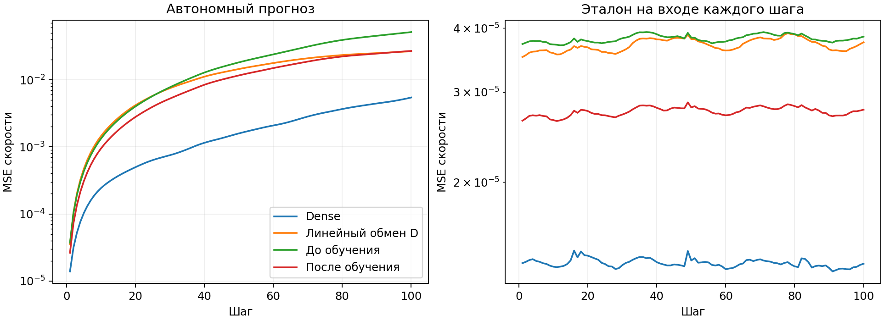

# CylinderFlow · дистилляция блоков 7–8 в один нелинейный блок

**Дистилляция снизила E100 на 47,6% относительно необученной замены при той же архитектуре и практически той же задержке.** По сравнению с линейным обменом D обученный блок дал меньшую среднюю ошибку автономного прогноза, но немного большую E100 и более высокий T100.

**POLUS 1624841, DONE**, normal, одна Tesla P100 на C2, лимит 45 минут, 4 CPU-слота, 8 ГиБ. Фактические 1093 с выполнения, 1040 МБ пика RAM по LSF. Проверены SHA-256 всех 170 файлов, полны 64 автономных окна, 64 окна с эталоном на входе и 256 таймингов. Отказов и нечисловых значений нет. Все покадровые ошибки A и D во всех 16 окнах совпали с архивом задания 1623806. [Протокол](PROTOCOL.md) · [Проверка](verification.json)

| Вариант | Медиана T100, с [Q1–Q3] | Парное ускорение к A | E100 | Δ E100 к A | Средняя MSE 1–100 | Средняя одношаговая MSE с эталоном |
|---|---:|---:|---:|---:|---:|---:|
| A · Dense, 15 блоков | 2,399 [2,383–2,485] | 1,000× | 0,005444 | 0% | 0,002010 | 1,390×10⁻⁵ |
| D · Одно линейное графовое обновление | 2,197 [2,181–2,274] | 1,092× | 0,026574 | +388,1% | 0,014028 | 3,707×10⁻⁵ |
| До · Блок 7 без обучения | 2,254 [2,238–2,334] | 1,064× | 0,051450 | +845,1% | 0,021163 | 3,814×10⁻⁵ |
| После · Блок 7 после дистилляции | 2,253 [2,237–2,334] | 1,065× | 0,026940 | +394,9% | 0,012413 | 2,749×10⁻⁵ |

1. **До дистилляции.** Сохранение блока 7 без блока 8 экономит медианные 146 мс на 100 шагов. E100 в 9,45 раза выше исходной.
2. **Эффект дистилляции.** E100 снизилась на 0,024510, на всех восьми траекториях. Разведочный 95%-й парный интервал [−0,038171, −0,011096]. Средняя автономная MSE снизилась на 41,3%. Парная медиана T100 отличается на −1,21 мс. IQR отношения времени до/после [0,9996, 1,0015] показывает, что разница сопоставима с разбросом замера. Обе модели выполняют 14 стандартных блоков и содержат по 2 184 194 параметра.
3. **Одношаговый и автономный прогноз.** На фоне меньшей feature loss одношаговая MSE с эталоном на входе уменьшилась на 27,9%. На первом автономном шаге E1 снизилась с 3,721×10⁻⁵ до 2,636×10⁻⁵. Улучшились и средняя ошибка автономного прогноза, и E100. Эксперимент показывает совместное улучшение метрик для этой замены.
4. **Сравнение с Dense и D.** After экономит медианные 148 мс к Dense, около 6,1%. E100 выше на 394,9%, что значительно превышает описательную отметку +10%. Против D After улучшает среднюю автономную MSE на 11,5% и одношаговую на 25,8%. T100 After на 57,6 мс выше D, медленнее во всех 64 парах. E100 After лучше на шести траекториях из восьми, но средняя разность +0,000366 (+1,38%). Разведочный интервал [−0,000850, +0,002074] включает оба знака. Для приоритета E100 и задержки преимущество After над D не установлено.

Парное ускорение — медиана отношения времен внутри совпадающего окна и повтора. Качество усредняется по двум окнам внутри каждой траектории, затем по восьми траекториям. Для интервалов использовано 10 000 парных bootstrap-выборок целых траекторий, seed 101. [Агрегаты](summary.csv) · [Парные сравнения](contrasts.csv)



| Validation ID | E100 до | E100 после | После − до |
|---:|---:|---:|---:|
| 87 | 0,117223 | 0,071955 | −0,045268 |
| 19 | 0,114507 | 0,067618 | −0,046889 |
| 72 | 0,007083 | 0,000665 | −0,006418 |
| 15 | 0,042713 | 0,012849 | −0,029864 |
| 18 | 0,005801 | 0,000955 | −0,004845 |
| 80 | 0,009853 | 0,001291 | −0,008561 |
| 79 | 0,003916 | 0,000841 | −0,003075 |
| 88 | 0,110504 | 0,059343 | −0,051162 |

[Все парные результаты по траекториям](trajectories.csv)

| Ошибка скрытых состояний | Fit до → после | Отложенные train до → после |
|---|---:|---:|
| Узлы | 1,013040 → 0,065655 | 1,013362 → 0,072159 |
| Рёбра | 0,989146 → 0,175368 | 0,989457 → 0,181955 |
| Равновзвешенная | 1,001093 → 0,120511 | 1,001410 → 0,127057 |

Train ID 199, 367, 552, 595, 867, 930, 946, 988. Отложенные train ID 151, 368, 634, 696. Кадры 100, 200, 300 и 400. Выбран минимум held-out feature MSE на эпохе 8, обновление 256. Полная подготовка и дистилляция заняли 83,57 с, в том числе 80,27 с на индексацию и кэш учителя и 2,95 с на цикл оптимизации с feature-оценкой. [Потери по эпохам](feature-losses.csv) · [Конфигурация](../../../configs/experiments/meshgraphnet_cylinderflow_distillation.yaml)

GPU-проверка установила точное равенство начальных выходов двух студентов и точное воспроизведение после reload. Независимое сравнение скачанных тензоров с исходным checkpoint подтвердило, что Before совпадает с Dense после физического удаления блока 8, а After восстанавливается заменой единственного блока 7. Хеши всех прочих тензоров, включая нормализаторы, совпали.

- Выполненный source `ab9fc50d4a101370180f8fded18fd44c9fa3d7c2`. Исходный чекпойнт 47 000 обновлений, LSF 1618479, SHA-256 `d4a3360760f191d4b05ee80111a32067f33aea5609466b12328b4e802b2a1386`.
- Модель Before и сохранённый блок After — `collected/results/before-model.pt` и `collected/results/distilled-block.pt` под внешним корнем ниже. SHA-256 блока `03135d9a5c0aeefcf1300c595c1952003219edffa0d92a3b404a907fe1d5e1ab`. Сырые измерения — `collected/results/timing/`, табличный экспорт — `analysis/raw-timing.csv` и `analysis/paired-timing.csv`.
- Внешний корень `${GNN_ARTIFACT_ROOT}/meshgraphnet-block-distillation-20261121/`. Архив `collected/run.tar.gz` SHA-256 `982b8a369308137315eeac7550ca96010ed393db1258d115abdf881a25e05565`. На POLUS исходные файлы лежат в `~/gnn-p100-20261110/meshgraphnet-block-distillation-20261121/`.

Оценка относится к одному чекпойнту, паре блоков 7–8, 256 обновлениям и этим восьми диагностическим траекториям. Test оставлен для независимой проверки. Ориентир +10% использован только для описания результата.

```bash
root="$GNN_ARTIFACT_ROOT/meshgraphnet-block-distillation-20261121"
archive="$GNN_ARTIFACT_ROOT/meshgraphnet-linear-exchange-20261120/collected/results"
python scripts/analyze_cylinderflow_block_distillation.py "$root/collected/results" "$archive" "$root/analysis-reproduction"
```
