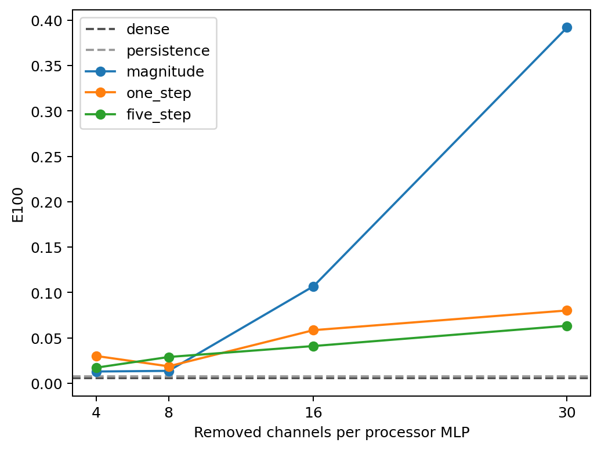

# MeshGraphNet на CylinderFlow · сравнение трёх критериев прунинга

POLUS **1618600, DONE**. Пятишаговый отбор дал меньшую среднюю E100, чем одношаговый, на трёх из четырёх уровней. При 2,644% сжатия результат обратный. На каждом уровне все сжатые модели уступили dense и постоянной начальной скорости по средней E100. Измеренные задержки близки к dense. [Протокол](../PROTOCOL.md) · [Сбор и хеш архива](../COLLECTION.md)

## Основная метрика

E100 — MSE скорости по двум компонентам на активных узлах на шаге 100. Сначала усреднялись окна с кадров 100 и 300 внутри траектории, затем восемь траекторий с равным весом. В скобках указано относительное увеличение E100 от dense. Dense **0,005444**, persistence **0,007397** (+35,9%) для всех четырёх сравнений.

| Удалено на MLP | Ширина | Параметры | Сжатие | Magnitude | Одношаговый | Пятишаговый |
|---:|---:|---:|---:|---:|---:|---:|
| 4 | 124 | 2 302 090 | 1,322% | 0,012874 (+136,5%) | 0,029980 (+450,7%) | 0,017109 (+214,3%) |
| 8 | 120 | 2 271 250 | 2,644% | 0,013578 (+149,4%) | 0,018594 (+241,6%) | 0,028868 (+430,3%) |
| 16 | 112 | 2 209 570 | 5,288% | 0,106866 (+1863,0%) | 0,058448 (+973,6%) | 0,040946 (+652,1%) |
| 30 | 98 | 2 101 630 | 9,915% | 0,392014 (+7101,0%) | 0,080139 (+1372,1%) | 0,063306 (+1062,9%) |



Парная разность равна E100 пятишагового минус E100 одношагового. Отрицательное значение означает меньшую ошибку пятишагового. 95%-интервалы — процентили 10 000 парных bootstrap-выборок целых траекторий, seed 101. В каждой выборке оба окна, все методы и уровни используют одни и те же индексы. Интервалы разведочные, без поправки на множественные сравнения, условны на одном чекпойнте, генераторе и уже использованном при разработке диагностическом наборе. Ничьи для подсчёта исходов определены по численному допуску протокола `1e-9 + 1e-4 × max(|a|, |b|)`. Это допуск на равенство, без порога практической значимости.

| Сжатие | Δ E100 | 95%-интервал | Победы / ничьи / поражения |
|---:|---:|---:|---:|
| 1,322% | −0,012871 | [−0,021860; −0,004767] | 8 / 0 / 0 |
| 2,644% | +0,010274 | [+0,003083; +0,018244] | 3 / 0 / 5 |
| 5,288% | −0,017502 | [−0,026069; −0,008881] | 7 / 0 / 1 |
| 9,915% | −0,016833 | [−0,026349; −0,008823] | 8 / 0 / 0 |

Все 12 сжатых снимков уступили dense на каждой из восьми траекторий. Persistence выиграла у dense на 2 из 8. При 2,644% пятишаговый выиграл у одношагового на ID 72, 18 и 80. При 5,288% единственное поражение — ID 80. [Все метрики по траекториям](trajectories.csv) · [Парные разности и исходы по траекториям](trajectory_contrasts.csv) · [Интервалы и суммарные исходы](contrasts.csv)

## Короткие горизонты и стоимость

На диагностических траекториях одношаговый имеет меньшую E1, чем пятишаговый, на всех четырёх уровнях. По средней MSE шагов 1–5 пятишаговый выигрывает только при 1,322%. На этом уровне E1 и средняя MSE 1–5 всех сжатых моделей выше dense, при том что обе ошибки ниже persistence. Этот рисунок повторяется и на остальных уровнях. В таблице ошибка умножена на 1000. [Полные E1/E5/E20/E50/E100, средние MSE 1–5, 1–20, 1–100 и стоимость](aggregate.csv)

| Сжатие | E1, M / 1 / 5 | Средняя MSE 1–5, M / 1 / 5 | Поиск, с, M / 1 / 5 | Задержка, мс, M / 1 / 5 |
|---:|---:|---:|---:|---:|
| 1,322% | 0,0313 / 0,0226 / 0,0236 | 0,1226 / 0,1067 / 0,1001 | <0,001 / 5,30 / 19,17 | 27,521 / 27,501 / 27,557 |
| 2,644% | 0,0432 / 0,0331 / 0,0388 | 0,1750 / 0,1608 / 0,1633 | <0,001 / 10,56 / 38,28 | 27,453 / 27,454 / 27,453 |
| 5,288% | 0,0930 / 0,0538 / 0,0738 | 0,6046 / 0,3137 / 0,4277 | 0,002 / 21,04 / 76,32 | 27,410 / 27,352 / 27,390 |
| 9,915% | 0,2083 / 0,1170 / 0,1261 | 1,7421 / 0,9284 / 0,9877 | 0,003 / 39,44 / 142,82 | 27,416 / 27,448 / 27,418 |

M / 1 / 5 — magnitude, одношаговый, пятишаговый соответственно. Поиск накопительный до снимка по таймерам решений. На каждом уровне все стратегии рассмотрели по 16/32/64/120 кандидатов. Число поисковых forward-вызовов по уровням равно 0/0/0/0 для magnitude, 128/256/512/960 для одношагового и 640/1280/2560/4800 для пятишагового. Замеры поиска пятишагового к последнему снимку дали 3,62× времени одношагового. Отдельные проверки моделей и оценка диагностических окон в эту стоимость не входят.

Средняя задержка dense — 27,540 мс. Для сжатых моделей диапазон средних составляет 27,352–27,557 мс. Замер относится к одному шагу на крупнейшей диагностической сетке, P100 узла C3, 5 прогревочных и 20 синхронизированных измерений. Разница средних от dense меньше 0,7% по модулю. Такой замер не устанавливает устойчивого ускорения.

Jaccard удалённых ID для одношагового и пятишагового по уровням — 0,341 / 0,266 / 0,208 / 0,282. Jaccard оставленных ID — 0,969 / 0,926 / 0,829 / 0,707. Ни в одном парном сравнении методов на снимках нет MLP с совпадающим набором удалённых ID. Одношаговый и пятишаговый выбрали одного кандидата на первом шаге и разошлись на втором. Общая библиотека гарантирована при одинаковой родительской маске. [Перекрытие всех пар масок](mask_overlap.csv) · [Аудит решений](decision_audit.csv)

## Проверка и границы вывода

- **Независимо пересчитано.** Сверены 323 файловых SHA-256. По архивному checkpoint 47 000 восстановлены dense-ранги, все 360 кандидатов, оценки из сохранённых кривых и все 45 победителей. В пределах численного допуска ни в одном решении не было второго кандидата. Исходные ID вложены корректно. Все 12 физических checkpoint точно совпали с независимыми срезами dense-тензоров, включая неизменные буферы нормализаторов. Ширины и числа параметров совпадают между стратегиями на каждом уровне. В 224 диагностических окнах — 0 пропусков и 0 отказов. Все 1 920 окон отбора также конечны. Независимо пересчитанные агрегаты, парные интервалы и перекрытия совпали со штатным анализом.
- **Измерено исполнителем POLUS.** Покадровые ошибки, задержка, память и время поиска взяты из сохранённых записей. Сводки задержки сверены с 20 исходными отсчётами. Предсказания и замеры заново не выполнялись. Test не открывался, обучение и новые задания не запускались.

Пятишаговый критерий может уменьшить E100 относительно одношагового, но эффект меняет знак вдоль вложенной траектории сжатия. Превосходство по отношению к dense или persistence в этом сравнении не показано. **Следующий шаг** — заранее зарегистрированная репликация этих четырёх уровней на свежих validation-траекториях и независимых dense-чекпойнтах с теми же базовыми линиями и учётом поисковых затрат. Здесь репликация не запускалась.

## Воспроизведение

Из корня репозитория, с установленными зависимостями анализа и локальным архивом. Каталоги вывода должны быть новыми.

```bash
root="$GNN_ARTIFACT_ROOT/meshgraphnet-channel-selection-20261113"
dense="$GNN_ARTIFACT_ROOT/meshgraphnet-mask-diagnostic-20261113/collected/best.pt"
python scripts/analyze_cylinderflow_channel_selection.py "$root/collected/results" "$root/analysis-reproduction"
PYTHONPATH=src python scripts/audit_cylinderflow_channel_selection.py \
  "$root/collected" "$root/analysis-reproduction" "$dense" "$root/audit-reproduction"
```
