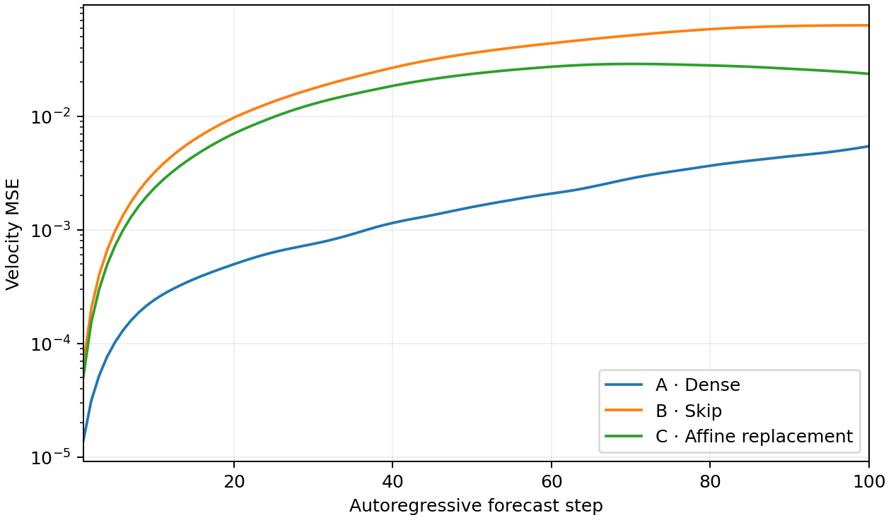

# CylinderFlow · замена блоков 7–8 линейными картами

**LSF 1623799, DONE.** Одна Tesla P100 на C2, очередь normal, 4 CPU-слота, таймлимит 45 минут. LSF записал 952 с выполнения и 1115 МБ пика RAM. Сверены 81 файловый SHA-256. Все 48 научных окон и 288 измерений T100 полные, без нечисловых результатов. Dense точно воспроизвёл 16 сохранённых кривых MSE из LSF 1618600, максимальная абсолютная разность 0. [Протокол](PROTOCOL.md) · [Проверка сбора](verification.json)

| Вариант | Медиана T100, с [Q1, Q3] | Парное ускорение к A | E100 | Δ E100 к A | Средняя MSE, шаги 1–100 |
|---|---:|---:|---:|---:|---:|
| A · Dense | 2,379 [2,359; 2,463] | 1,000× | 0,005444 | 0% | 0,002010 |
| B · Обход блоков | 2,093 [2,076; 2,165] | 1,137× | 0,063170 | +1060,4% | 0,034431 |
| C · Линейная замена | 2,114 [2,098; 2,189] | 1,125× | 0,023649 | +334,4% | 0,018803 |

- **Обход** сэкономил 286 мс на 100 шагов по медиане парных разностей. Диапазон экономии 279–302 мс по 96 парам, около 12,0% времени A.
- **Линейная замена против обхода** снизила среднюю E100 на 62,6% и восстановила 68,5% прироста ошибки от обхода. E100 улучшилась на всех восьми траекториях. Цена — медианные 22,1 мс на 100 шагов, диапазон 18,5–27,0 мс. C было медленнее B во всех 96 парах.
- **Линейная замена против dense** сэкономила медианные 264 мс, около 11,1% T100. E100 оказалась в 4,34 раза выше dense и выросла на всех восьми траекториях. +334,4% существенно выше описательной отметки +10%. Отметка не использовалась при выборе коэффициента, выполнении или анализе окон.

Ускорение рассчитано как медиана отношений T100 внутри одинаковой пары «траектория, старт, повтор». На обоих сравнениях с A все 96 пар быстрее dense. IQR ускорения составляет 1,1362–1,1370× для B и 1,1245–1,1250× для C. Пул задержек варьируется сильнее из-за разных окон, поэтому вывод опирается на парные сравнения. Эти повторы описывают разброс внутри одного задания и одной GPU. [Все агрегаты](summary.csv) · [Парные сравнения](contrasts.csv)



E100 усреднена по двум окнам внутри траектории, затем по восьми траекториям. Парная Δ(C−A) равна +0,018205, исследовательский 95%-й интервал [+0,004825; +0,033169]. Δ(C−B) равна −0,039521 [−0,061833; −0,016873]. Интервалы получены из 10 000 bootstrap-выборок целых траекторий с обоими окнами, seed 101. [Таблица по траекториям](trajectories.csv)

| Validation ID | A E100 | B E100 | C E100 | C−A | C−B |
|---:|---:|---:|---:|---:|---:|
| 87 | 0,015860 | 0,120577 | 0,044792 | +0,028932 | −0,075785 |
| 19 | 0,018322 | 0,133512 | 0,061433 | +0,043110 | −0,072079 |
| 72 | 0,000461 | 0,009265 | 0,001431 | +0,000970 | −0,007833 |
| 15 | 0,003668 | 0,077196 | 0,018517 | +0,014848 | −0,058680 |
| 18 | 0,000729 | 0,007892 | 0,001629 | +0,000900 | −0,006263 |
| 80 | 0,000769 | 0,012870 | 0,002485 | +0,001717 | −0,010384 |
| 79 | 0,000357 | 0,010509 | 0,001295 | +0,000938 | −0,009214 |
| 88 | 0,003384 | 0,133535 | 0,057608 | +0,054224 | −0,075927 |

Калибровка 84,24 с с индексацией train и без файлового хеширования или сохранения карт. Train ID 199, 367, 552, 595, 867, 930, 946, 988, кадры 100/200/300/400. Получены 8192 строки для узлов и 32768 для рёбер. Абсолютные ridge-штрафы 0,0013494 и 0,0046025. Точный reload карт проверен на P100. GPU-хуки подтвердили 15 исходных процессоров в A, 13 в B и 13 плюс замена в C. Хеши оставленных процессоров, энкодеров, декодера и нормализаторов совпали с dense. Параметры A/B/C составляют 2 332 930 / 2 035 458 / 2 068 482.

Выполненный source `f3b3458049ceb2fa5c13736254482dc5e71d1268`. Frozen checkpoint `continuation-02/run.1618479/best.pt`, Adam update 47 000, SHA-256 `d4a3360760f191d4b05ee80111a32067f33aea5609466b12328b4e802b2a1386`. [Конфигурация](../../../configs/experiments/meshgraphnet_cylinderflow_linear_block_pilot.yaml)

Архив `${GNN_ARTIFACT_ROOT}/meshgraphnet-linear-block-pilot-20261120/collected/run.tar.gz`, SHA-256 `31dc32b59f64871e92999322b2e288d2cfc053dc24ea58166e737a46ae4598e7`. Он содержит карты, сырые кривые и тайминги, GPU-проверки, журналы и квитанции. На POLUS те же результаты под `~/gnn-p100-20261110/meshgraphnet-linear-block-pilot-20261120/`.

Вывод ограничен одним checkpoint, блоками 7–8 и восемью диагностическими траекториями, ранее использованными для разработки. Пилот показывает частичное восстановление качества обхода с небольшой стоимостью affine-карт. При сравнении с плотной моделью выигрыш по времени сопровождается существенным ростом ошибки на 100-м шаге. Test не использовался.

```bash
root="$GNN_ARTIFACT_ROOT/meshgraphnet-linear-block-pilot-20261120"
archive="$GNN_ARTIFACT_ROOT/meshgraphnet-channel-selection-20261113/collected/results"
python scripts/analyze_cylinderflow_linear_block_pilot.py "$root/collected/results" "$archive" "$root/analysis-reproduction"
```
