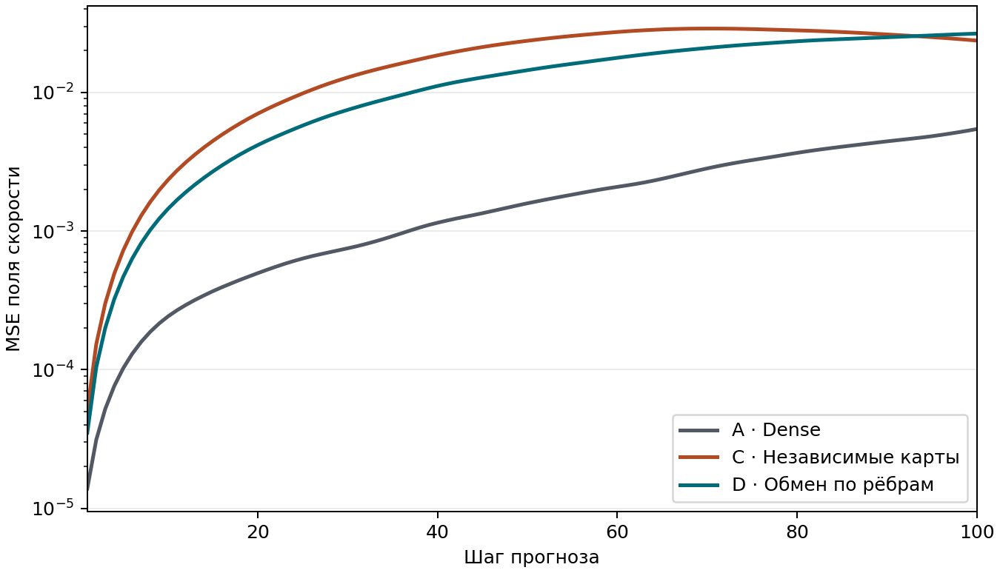

# CylinderFlow · замена блоков 7–8 одним линейным графовым блоком

**Средняя ошибка за траекторию снизилась на 25,4% относительно независимой линейной замены. На шаге 100 преимущество отсутствует.** Ускорение относительно полной сети сохранилось. Цена обмена — 62,6 мс на прогноз из 100 шагов относительно независимых карт.

Задание POLUS 1623806 завершилось успешно, RUN 948 с, одна P100 на C2. Калибровка D — 61,28 с, включая открытие train. При скачивании сверены SHA256 всех 68 файлов в results. Полны 48 окон модели и 288 измерений T100. Во всех прогнозах значения конечны. Все покадровые ошибки A и C совпали с архивом предыдущего пилота. [Протокол](PROTOCOL.md) · [Проверка](verification.json)

| Модель | Медиана T100, с | E20 | E50 | E100 | Средняя MSE 1–100 |
|---|---:|---:|---:|---:|---:|
| A · Полная MGN | 2,383 | 0,000498 | 0,001587 | 0,005444 | 0,002010 |
| C · Две независимые карты | 2,117 | 0,007045 | 0,023586 | 0,023649 | 0,018803 |
| D · Один линейный обмен | 2,179 | 0,004179 | 0,014473 | 0,026574 | 0,014028 |

У модели D в сравнении с C меньше средняя MSE за 100 шагов на всех восьми траекториях, парная разность −0,004775. Разведочный 95%-й bootstrap-интервал по восьми траекториям [−0,008681, −0,001346]. Покадровая средняя ошибка ниже с шага 1 по 93 включительно. Начиная с шага 94 выигрывает C. На последнем шаге D выигрывает у C на четырёх из восьми траекторий. Средняя разность D−C на шаге 100 равна +0,002925 (+12,4%), интервал [−0,001423, +0,009883]. Наибольшая разность приходится на ID 87, +0,02565. По этим восьми примерам устойчивый знак разницы конечной ошибки не установлен.



По всем 96 парным замерам D быстрее A и медленнее C. Медианная экономия против A — 204,8 мс, парное ускорение 1,093× (−8,5% времени). E100 D в 4,88 раза выше A. Даже при явном улучшении средней точности относительно C качество исходной сети остаётся недостигнутым. Число параметров у A/C/D равно 2 332 930 / 2 068 482 / 2 117 634. Вывод относится ко всей проверенной архитектурной замене, включая увеличение входных размерностей линейных карт. Один чекпойнт, одна позиция и восемь ранее использованных диагностических траекторий ограничивают перенос результата.

[Сводная таблица](summary.csv) · [Парные сравнения](contrasts.csv) · [Траектории](trajectories.csv) · [Кривые](curves.csv)

Код эксперимента — d0ac9a0. Внешний архив — `prunable_gnn_artifacts/meshgraphnet-linear-exchange-20261120/collected/run.tar.gz`. Коэффициенты и индивидуальные кривые лежат в collected/results. Воспроизведение анализа из корня репозитория:

```bash
python scripts/analyze_cylinderflow_linear_exchange.py \
  ../prunable_gnn_artifacts/meshgraphnet-linear-exchange-20261120/collected/results \
  ../prunable_gnn_artifacts/meshgraphnet-linear-block-pilot-20261120/collected/results \
  research/experiments/meshgraphnet_linear_exchange_20261120
```
