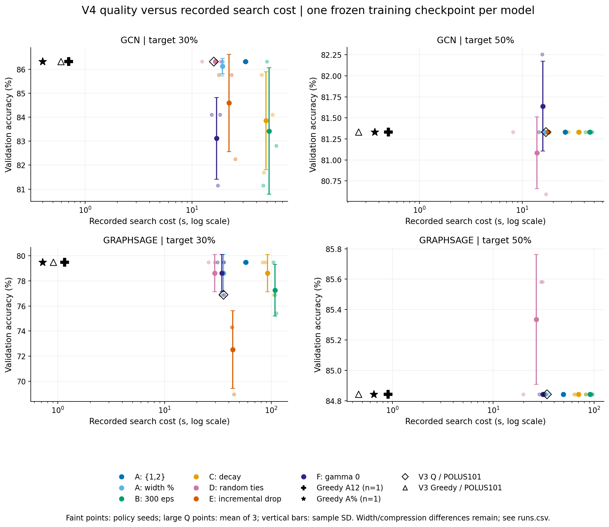
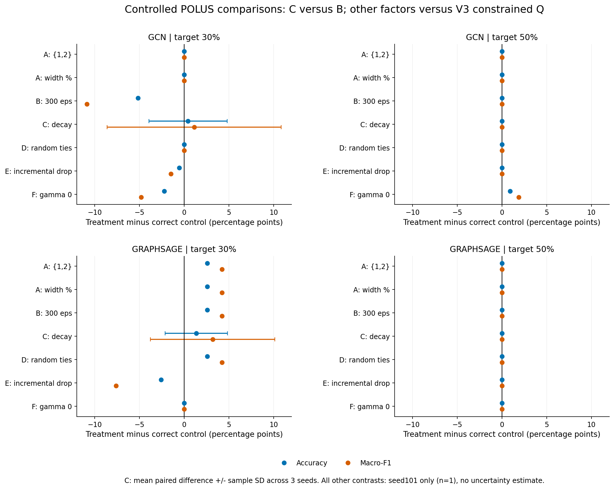
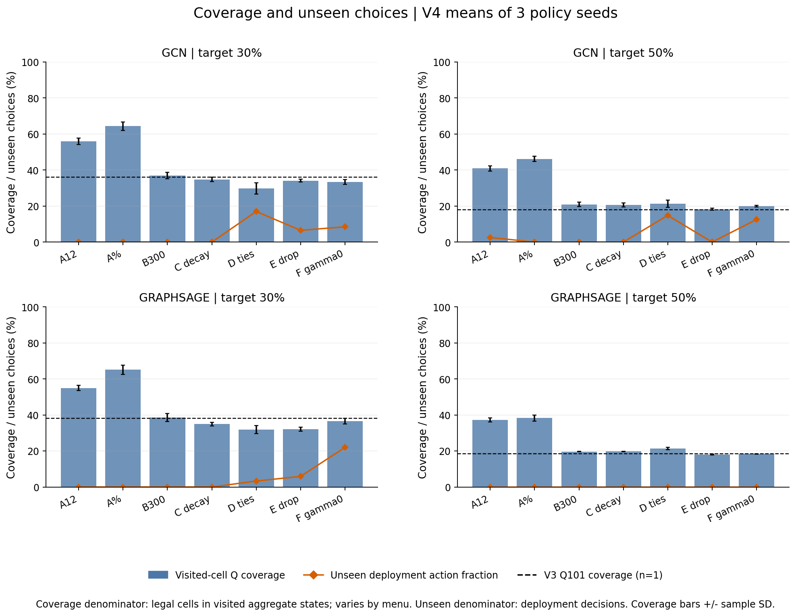
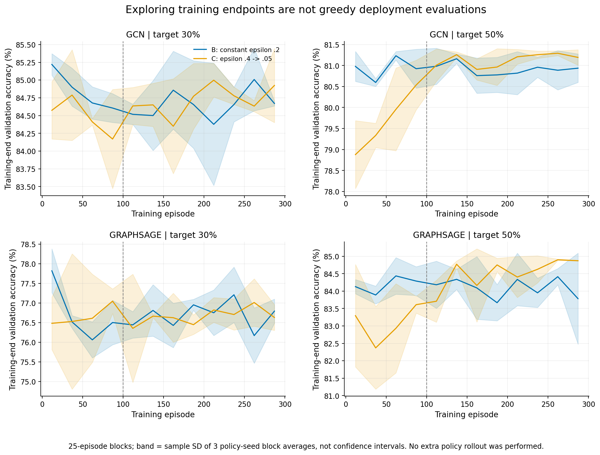

# V4 POLUS controlled tabular-Q campaign: verified analysis

**92/92 results pass independent offline verification.** All models reach the exact target band. Menu {1,2} matches its Greedy control in all 12 policy comparisons at much higher search cost; neither300 episodes, exploration decay, reward reformulation nor gamma0 produces a consistent quality advantage across the four model–target conditions. Small improvements in some random-tie/gamma0 runs coexist with different achieved compression/widths and worse cases. These are validation-only diagnostics on one frozen training checkpoint per model.

## Evidence and independent verification

Analysis date:2026-10-29. Frozen scientific source:`61e693440b53d3cac3136600f3208a73c02492db`; archive SHA256:`d80ea49be02c5e08ec7169a323b91c368875e4b42fab5dbeffb655ffca468704`. The primary archive contains 84 Q tasks and 8 deterministic menu-matched Greedy tasks. No capacity/smoke task, skipped optional seed or duplicate platform repeat enters primary summaries.

All 1,285 inventory files and 92 completed-marker output sets were rehashed. Verification covers 92 physical checkpoints plus 20 historical references, 13,200 primary learning episodes, 137,000 transitions, 44,474 final Q entries, and all 300 snapshots. It independently checks exact integer parameter geometry, width-dependent BFS reachability/horizon, legal actions, magnitude-based retained IDs at every transition, reward/terminal penalty arithmetic, seeded RNG/exploration/tie choices, Bellman updates, visited-cell Q coverage and snapshot Q/RNG state. Final models reload strictly and equal dense-tensor projections; all final validation accuracy/F1 values are independently recomputed and agree.

Verification uses existing local Torch2.2.2/PyG2.6.1 on CPU, two threads; recorded POLUS results use Torch2.0.1/PyG2.4.0, POWER8 ppc64le, four threads. Archived native metrics/timings remain the reported results. Every non-validation label is masked to−1; no test-set metric or new search/training/rollout/timing experiment is performed. Intermediate validation observations are audited/replayed, not reevaluated. Greedy counterfactual candidate outputs were not recorded, so their argmax is not independently reexecuted; chosen-action legality, counts, rewards, projection, reload and final metrics are checked. The checker has 10 offline tests, including rejection of altered rewards, Q values, IDs, terminal behavior, actions and coverage.

## Correct controls and statistical units

- **A menus, B300, D ties, E reward, F gamma:** the controlled remote reference is V3 `q_reachable_v3`, POLUS seed101. Thus native single-factor comparisons for these variants have **n=1 per model/target**, not n=3. D is compared to constrained Q, not to the old unconstrained V3 random-tie variant.

- **C decay:** compare to V4 B300 (same300 episodes), with all three matched POLUS policy seeds101/5001/5002. Comparing C to the 100-episode reference would change two factors.

- **Local V3 seeds5001/5002:** retained as explicit cross-platform developmental references only. Their contrasts are labelled `cross_platform_reference_only`; cross-platform search ratios are deliberately absent. Local101 remains a bridge reference, not an additional independent sample. No n=4 pooling occurs.

- **Matched Greedy:** each alternative menu has one deterministic POLUS control per model/target; compare three Q policy seeds to that fixed control. Standard-menu Greedy is reused from V3 POLUS101. For E it remains a descriptive control with a reward mismatch, not an incremental-reward Greedy ablation.

All Q seeds share dense training seed101 and the same graph/split; they quantify policy RNG variation, not variation across trained GNNs or datasets. SD below is sample SD across three policy seeds, not a confidence interval. Greedy n=1 has no estimated SD. Within-band compression differences are retained; equal requested targets do not imply equal architectures.

Native historical constrained-Q reference (n=1, seed101):

| Model | Target | Acc % | Macro-F1 % | Widths | Compression % | Search s |
|---|---|---|---|---|---|---|
| GCN | 30% | 86.32 | 83.19 | 23/16 | 29.020 | 15.98 |
| GCN | 50% | 81.33 | 72.81 | 16/32 | 49.721 | 16.97 |
| GRAPHSAGE | 30% | 76.89 | 68.64 | 23/15 | 29.080 | 35.70 |
| GRAPHSAGE | 50% | 84.84 | 82.49 | 16/32 | 49.742 | 34.15 |

All 16 existing Q references were checked against committed V3 completion/checkpoint hashes. For **all 16 references**, B300 has exactly the same first100 training observations and exactly the same Q table in its100-episode snapshot. This supports the controlled episode-prefix implementation. A snapshot is not a new100-episode greedy deployment evaluation, and this agreement does not create missing POLUS timing/replicate evidence for 5001/5002.

Local reference endpoints (reported individually, not pooled into native controls):

| Model | Target | Local5001: Acc/F1; widths | Local5002: Acc/F1; widths |
|---|---|---|---|
| GCN | 30% | 82.81/74.32; 23/13 | 85.77/81.71; 23/15 |
| GCN | 50% | 81.33/72.81; 16/32 | 81.33/72.81; 16/32 |
| GRAPHSAGE | 30% | 79.48/72.87; 23/16 | 75.42/63.33; 23/12 |
| GRAPHSAGE | 50% | 84.84/82.49; 16/32 | 84.84/82.49; 16/32 |

## Primary POLUS results

Accuracy/F1: percentages, mean±sample SD for Q (n=3). Compression: exact parameter reduction, displayed as a percentage mean; `runs.csv` preserves every fraction, count, width, retained ID and policy seed. Width lists follow101;5001;5002, with one width pair for Greedy. Search cost includes policy/environment/recording work; it is not inference latency.

### GCN, target 30%

| Variant | n | Accuracy % | Macro-F1 % | Compression % | Widths | Search s (mean) |
|---|---|---|---|---|---|---|
| A: {1,2} | 3 | 86.32 ± 0.00 | 83.19 ± 0.00 | 29.020 | 23/16; 23/16; 23/16 | 31.64 |
| A: width % | 3 | 86.14 ± 0.32 | 82.70 ± 0.85 | 29.042 | 23/16; 23/15; 23/16 | 19.20 |
| B: 300 episodes | 3 | 83.43 ± 2.64 | 76.60 ± 5.79 | 29.195 | 23/11; 23/16; 23/13 | 52.42 |
| C: decaying epsilon | 3 | 83.86 ± 2.04 | 77.72 ± 4.35 | 29.173 | 23/14; 23/12; 23/15 | 49.26 |
| D: random ties | 3 | 86.32 ± 0.00 | 83.19 ± 0.00 | 29.020 | 23/16; 23/16; 23/16 | 16.51 |
| E: incremental drop | 3 | 84.60 ± 2.03 | 79.26 ± 4.26 | 29.217 | 23/15; 23/15; 23/9 | 22.19 |
| F: gamma0 | 3 | 83.12 ± 1.71 | 76.35 ± 3.50 | 29.217 | 23/14; 23/11; 23/14 | 16.96 |
| Greedy {1,2} | 1 | 86.32 (n=1) | 83.19 (n=1) | 29.020 | 23/16 | 0.70 |
| Greedy width % | 1 | 86.32 (n=1) | 83.19 (n=1) | 29.020 | 23/16 | 0.40 |

### GCN, target 50%

| Variant | n | Accuracy % | Macro-F1 % | Compression % | Widths | Search s (mean) |
|---|---|---|---|---|---|---|
| A: {1,2} | 3 | 81.33 ± 0.00 | 72.81 ± 0.00 | 49.738 | 16/31; 16/32; 16/32 | 26.17 |
| A: width % | 3 | 81.33 ± 0.00 | 72.81 ± 0.00 | 49.789 | 16/32; 16/32; 16/28 | 16.54 |
| B: 300 episodes | 3 | 81.33 ± 0.00 | 72.81 ± 0.00 | 49.721 | 16/32; 16/32; 16/32 | 45.31 |
| C: decaying epsilon | 3 | 81.33 ± 0.00 | 72.81 ± 0.00 | 49.721 | 16/32; 16/32; 16/32 | 35.50 |
| D: random ties | 3 | 81.08 ± 0.43 | 71.98 ± 1.44 | 50.010 | 16/32; 16/28; 16/19 | 13.91 |
| E: incremental drop | 3 | 81.33 ± 0.00 | 72.81 ± 0.00 | 49.721 | 16/32; 16/32; 16/32 | 17.85 |
| F: gamma0 | 3 | 81.64 ± 0.53 | 73.44 ± 1.08 | 49.908 | 16/21; 16/32; 16/32 | 15.84 |
| Greedy {1,2} | 1 | 81.33 (n=1) | 72.81 (n=1) | 49.721 | 16/32 | 0.50 |
| Greedy width % | 1 | 81.33 (n=1) | 72.81 (n=1) | 49.721 | 16/32 | 0.37 |

### GRAPHSAGE, target 30%

| Variant | n | Accuracy % | Macro-F1 % | Compression % | Widths | Search s (mean) |
|---|---|---|---|---|---|---|
| A: {1,2} | 3 | 79.48 ± 0.00 | 72.87 ± 0.00 | 29.015 | 23/16; 23/16; 23/16 | 57.58 |
| A: width % | 3 | 78.62 ± 1.49 | 71.46 ± 2.44 | 29.037 | 23/16; 23/16; 23/15 | 35.52 |
| B: 300 episodes | 3 | 77.26 ± 2.06 | 68.28 ± 4.78 | 29.123 | 23/16; 23/15; 23/12 | 108.25 |
| C: decaying epsilon | 3 | 78.62 ± 1.49 | 71.46 ± 2.44 | 29.037 | 23/15; 23/16; 23/16 | 92.26 |
| D: random ties | 3 | 78.62 ± 1.49 | 71.46 ± 2.44 | 29.037 | 23/16; 23/16; 23/15 | 29.50 |
| E: incremental drop | 3 | 72.52 ± 3.09 | 58.07 ± 5.14 | 29.446 | 23/9; 23/9; 23/10 | 43.51 |
| F: gamma0 | 3 | 78.62 ± 1.49 | 71.46 ± 2.44 | 29.037 | 23/15; 23/16; 23/16 | 34.48 |
| Greedy {1,2} | 1 | 79.48 (n=1) | 72.87 (n=1) | 29.015 | 23/16 | 1.15 |
| Greedy width % | 1 | 79.48 (n=1) | 72.87 (n=1) | 29.015 | 23/16 | 0.72 |

### GRAPHSAGE, target 50%

| Variant | n | Accuracy % | Macro-F1 % | Compression % | Widths | Search s (mean) |
|---|---|---|---|---|---|---|
| A: {1,2} | 3 | 84.84 ± 0.00 | 82.49 ± 0.00 | 49.758 | 16/31; 16/32; 16/32 | 49.63 |
| A: width % | 3 | 84.84 ± 0.00 | 82.49 ± 0.00 | 49.775 | 16/30; 16/32; 16/32 | 32.59 |
| B: 300 episodes | 3 | 84.84 ± 0.00 | 82.49 ± 0.00 | 49.742 | 16/32; 16/32; 16/32 | 91.62 |
| C: decaying epsilon | 3 | 84.84 ± 0.00 | 82.49 ± 0.00 | 49.742 | 16/32; 16/32; 16/32 | 70.44 |
| D: random ties | 3 | 85.34 ± 0.43 | 83.02 ± 0.46 | 49.908 | 16/30; 16/28; 16/28 | 26.80 |
| E: incremental drop | 3 | 84.84 ± 0.00 | 82.49 ± 0.00 | 49.742 | 16/32; 16/32; 16/32 | 31.57 |
| F: gamma0 | 3 | 84.84 ± 0.00 | 82.49 ± 0.00 | 49.742 | 16/32; 16/32; 16/32 | 31.09 |
| Greedy {1,2} | 1 | 84.84 (n=1) | 82.49 (n=1) | 49.742 | 16/32 | 0.90 |
| Greedy width % | 1 | 84.84 (n=1) | 82.49 (n=1) | 49.742 | 16/32 | 0.65 |



Figure1: individual policy seeds and Q means±sample SD; controls and V3 references have n=1. The log cost axis is deliberate. Apparent quality comparisons also require achieved compression and retained-ID checks.

## Controlled factor effects

Each table entry is treatment−correct control in **accuracy / macro-F1 percentage points**. A/B/D/E/F entries use matched native seed101 only. C entries are the mean of three native seed-paired differences against B300; individual deltas and compression changes are in `comparisons.csv`.

| Factor | GCN30 | GCN50 | GraphSAGE30 | GraphSAGE50 |
|---|---|---|---|---|
| A: {1,2} | +0.00 / +0.00 | +0.00 / +0.00 | +2.59 / +4.23 | +0.00 / +0.00 |
| A: width % | +0.00 / +0.00 | +0.00 / +0.00 | +2.59 / +4.23 | +0.00 / +0.00 |
| B: 300 episodes | -5.18 / -10.88 | +0.00 / +0.00 | +2.59 / +4.23 | +0.00 / +0.00 |
| C: decaying epsilon | +0.43 / +1.12 | +0.00 / +0.00 | +1.36 / +3.18 | +0.00 / +0.00 |
| D: random ties | +0.00 / +0.00 | +0.00 / +0.00 | +2.59 / +4.23 | +0.00 / +0.00 |
| E: incremental drop | -0.55 / -1.47 | +0.00 / +0.00 | -2.59 / -7.60 | +0.00 / +0.00 |
| F: gamma0 | -2.22 / -4.82 | +0.92 / +1.87 | +0.00 / +0.00 | +0.00 / +0.00 |



**A — action menus.** {1,2} produces the same accuracy/F1 as matched Greedy in 12/12 policy comparisons, including both models and targets; the width-percent menu ties in 10/12 and is worse in 2/12, with no improvements. At 30%, {1,2} ends at 23/16 in all six Q runs. The percent menu sometimes removes an additional second-layer channel. Higher observed Q coverage for small menus partly reflects a smaller legal-action denominator; it is not evidence of greater full-state learning coverage. Percent deletions use ceiling on the current width, deduplicated:32→{2,4},30→{2,3},10→{1}; this is not a fixed {1,2} menu.

**B — episode budget.** All 100-episode prefixes match archived controls exactly. At native seed101, increasing to 300 episodes reduces GCN30 accuracy by 5.18pp/F1 by 10.88pp while improving GraphSAGE30 by 2.59pp/4.23pp; both 50% endpoints remain unchanged. This is not consistent improvement with more episodes. Recorded seed101 search is 2.75–2.93× the historical100-episode reference, but V4 adds decision/snapshot bookkeeping and uses a different reachability implementation; this inter-campaign timing ratio is descriptive, not an isolated causal estimate of episode cost.

**C — exploration schedule.** Against B300, mean30% accuracy changes are+0.43pp (GCN) and+1.36pp (GraphSAGE), with F1 changes+1.12pp/+3.18pp. In each30% cell two seeds improve and one worsens. All 50% accuracy/F1 endpoints tie. The schedule changes initial/final exploration and mean nominal epsilon (.225 versus.2), not decay alone at a fixed exploration budget. Observed training exploration fractions are23.7–26.3% for C versus19.7–20.2% for B, weighted by actual trajectory lengths. Mean recorded C search is 6.0%,21.6%,14.8%,23.1% lower than B for GCN30/GCN50/GraphSAGE30/GraphSAGE50 respectively; some individual pairs are slower. These are observed search/evaluation differences, not hardware speedups or convergence guarantees.

**D — equal-Q ties.** The same reachability filter is retained. At seed101, GCN endpoints and GraphSAGE50 tie the constrained reference; GraphSAGE30 gains2.59pp accuracy/4.23pp F1 and changes23/15→23/16. Across all V4 seeds, GraphSAGE50 has two small improvements over standard Greedy, but with extra second-layer pruning (28/30 channels instead of 32). The observed result is conditional on tie resolution and selected architectures; it is not a general superiority claim.

D uses the same Python RNG for epsilon decisions and tied-max choices. Extra tie draws can also change later realized exploration draws. Thus matched seed means the same initial RNG seed, not a frozen common exploration-action stream; the contrast evaluates the declared random-tie policy as a whole.

**E — incremental-drop reward.** At seed101, GCN30 loses0.55pp accuracy/1.47pp F1 and GraphSAGE30 loses2.59pp/7.60pp relative to the native baseline; both 50% cells tie. GraphSAGE30 selects23/9–23/10 across seeds, compared with Greedy23/16, and its mean F1 is 58.07% versus72.87% for Greedy. Achieved compression therefore differs: the reward effect includes its change to the selected trajectory/model, not quality at fixed widths.

The E equation is r_t=0.6Δs−0.4(D_t−D_prev)+P_t. Independently checked undiscounted sums telescope to 0.6s_T−0.4D_T+P_T. With gamma.9, however, the discounted drop term is gamma^(T−1)D_T + (1−gamma)Σ[t=1..T−1]gamma^(t−1)D_t. It retains intermediate-gap weighting and is not a policy-invariant terminal-only reformulation. Reward values from different definitions/gammas must not be ranked as a common quality metric. `reward_and_exploration.csv` includes offline rescoring of each already stored deployment path under the common repeated-drop/gamma.9 objective; no new policy was run.

**F — gamma0.** Every update has zero future-credit contribution, as verified from the trace. At seed101, GCN30 loses2.22pp accuracy/4.82pp F1, GCN50 gains0.92pp/1.87pp with widths16/21 instead of 16/32 (0.56pp more compression), and GraphSAGE endpoints tie the native reference. Gamma0 does not make the learned tabular policy equivalent to immediate Greedy: unseen actions, training visits and the aggregated state remain relevant.

In particular, gamma0 Q does not evaluate every legal candidate immediately before choosing, whereas Greedy does.

## Matched Greedy and quality versus cost

The following are **descriptive counts across 12 heterogeneous model–target–seed comparisons per variant**, not12 independent trained models or a pooled treatment effect. Each row reports accuracy better/tied/worse than its menu control. For E the repeated-drop standard Greedy reward is mismatched, so that row is descriptive only.

| Variant | Better / tied / worse | Observed search ratio Q/Greedy | Reward matched |
|---|---|---|---|
| A: {1,2} | 0 / 12 / 0 | 44.0–55.7× | yes |
| A: width % | 0 / 10 / 2 | 42.6–53.1× | yes |
| B: 300 episodes | 0 / 8 / 4 | 77.4–208.7× | yes |
| C: decaying epsilon | 0 / 8 / 4 | 74.9–179.4× | yes |
| D: random ties | 2 / 8 / 2 | 20.8–66.8× | yes |
| E: incremental drop | 0 / 6 / 6 | 29.9–72.1× | no; descriptive |
| F: gamma0 | 1 / 7 / 4 | 25.5–72.2× | yes |

For the two new menus the fully matched control costs make the tradeoff particularly clear: {1,2} Q costs44–56× Greedy with no accuracy improvement; percent-menu Q costs43–53× with ties or losses. Some D/F runs have slightly higher validation accuracy than standard Greedy at greater search cost and different compression. They are not a uniform win, and there is no measured inference-latency advantage in this campaign. Use the per-seed F1, exact compression, widths and retained-ID comparisons, rather than selecting the best policy seed.

## Coverage, unseen actions and stopping



Coverage means learned Q entries divided by legal state–action cells in the **visited aggregated states**, including terminal states with 0 legal cells. It is not coverage of every possible state or retained-channel mask. Menus change the denominator. At 30%, menu {1,2} has mean55–56% coverage and percent menus64–65%, while the native standard reference has 36–38% (seed101). Absolute entries/visited states/denominators and SDs are retained in the CSVs.

All 24 B/C deployments choose only previously updated actions, yet several30% endpoints are below Greedy. Conversely D can choose unseen actions and still improve particular endpoints. Unseen fraction alone is not a monotone quality indicator. Observed retained-ID aliasing occurs in 82/84 Q runs (0–28 aliased aggregate states per run); state–action reward conflicts are reported separately. The representation is unchanged across factors, so this diagnostic does not causally isolate aliasing as the reason for an outcome.

**Stopping:**89/92 deployments end with `target_band`; three menu-{1,2}30% deployments end at the 20-action limit (GCN seed5002; GraphSAGE seeds101/5002). All three are in band and preserve the original terminal-priority rule. Every deployment pays terminal penalty once (zero inside the band). STOP is unavailable outside the band; there is no evidence here that Q learned when to stop independently of the feasibility controller.

All audited training endpoints are also in band, so terminal penalties are zero throughout these constrained trajectories. The reward contrast concerns the running drop penalty, not successful propagation of a nonzero off-target terminal penalty.



Training endpoint curves summarize exploratory episodes, not greedy deployment policies. Shading is SD across three 25-episode policy-seed block means, not a confidence interval. Snapshots store Q and training RNG state only; no extra intermediate greedy policy evaluation is available.

## Execution cost and queue waiting

Primary search sums to 55.80 minutes. LSF primary active job time sums to 67.72 minutes; including capacity job1607752 it is 76.80 minutes. The reserved upper bound was 250 minutes, below the strict300-minute maximum. Actual active time was well below the 4–5h planning target; the campaign was not expanded or repeated to fill unused capacity. Optional seeds5003/5004 remain uniformly absent.

| Condition | Job ID | Active min | Queue-wait min | Turnaround min |
|---|---|---|---|---|
| capacity | 1607752 | 9.08 | 3.43 | 12.52 |
| gcn-t30 | 1607753 | 13.40 | 95.07 | 108.47 |
| gcn-t50 | 1607754 | 11.45 | 108.47 | 119.92 |
| graphsage-t30 | 1607755 | 23.03 | 119.92 | 142.95 |
| graphsage-t50 | 1607756 | 19.83 | 197.03 | 216.87 |

Queue waiting is LSF turnaround minus run time. It is excluded from active budget. Waiting intervals overlap across jobs, so their sum is not elapsed campaign duration; maximum primary turnaround is 216.87 minutes. CPU seconds are also distinct from wall seconds and are preserved in `execution_times.csv`. Search/worker time differences include imports, frozen-input validation, serialization and orchestration. Timing observations are not repeated isolated performance benchmarks; native V3 comparisons additionally differ in instrumentation, and local V3 timings are never pooled with POLUS.

## Reproducibility and limits

`runs.csv` has exactly 92 primary rows; `summary.csv` has 36 native model/target/variant groups; `baseline_runs.csv` keeps 20 historical references and their platforms separate. `comparisons.csv` separates 36 native seed-paired factor comparisons, 48 cross-platform references and 84 Greedy comparisons. `learning_blocks.csv`, `snapshots.csv`, `deployment_decisions.csv`, `prefix_checks.csv`, `reward_and_exploration.csv`, `verification.json` and `provenance.json` retain supporting diagnostics. Full 13,200 per-episode rows remain outside Git with the analysis record.

External analysis root:`/Users/perfect/Desktop/code/MSU/MSU_SQI_25_DIPLOMA/test_codex/prunable_gnn_artifacts/polus-v4-analysis-20261029T112436Z`. Original collection:`/Users/perfect/Desktop/code/MSU/MSU_SQI_25_DIPLOMA/test_codex/prunable_gnn_artifacts/polus-v4-collection-20261029T111126Z`. The original archive, 1,285 source files, launch/collection receipts, algorithms, earlier evidence and SITITO manuscript remain unchanged. Analysis tools are versioned here under `tools/`; plotting reads only derived files using the existing Python3.8/Matplotlib3.7.5 environment. No package/environment/network/server operation is needed for this analysis. Compact artifact hashes are in `analysis_manifest.json`.

Reproduce verification/aggregation using the existing Torch environment, from repository root:

```bash
PYTHONPATH=src python research/experiments/polus_v4_diagnostic_20261029/results/tools/verify_and_aggregate.py \
  --collection "/Users/perfect/Desktop/code/MSU/MSU_SQI_25_DIPLOMA/test_codex/prunable_gnn_artifacts/polus-v4-collection-20261029T111126Z" \
  --inputs "/Users/perfect/Desktop/code/MSU/MSU_SQI_25_DIPLOMA/test_codex/prunable_gnn_artifacts/polus-v4-diagnostic-20261029/inputs/manifest.json" \
  --output /path/to/fresh-external-output
```

Interpretation remains developmental: one graph, one dense training checkpoint per model, n=3 policy seeds, n=1 matched native historical reference for most factors, validation used for adaptive decisions, no test-set evaluation. No causal assertion extends beyond these controlled conditions. The evidence supports keeping strong menu-matched Greedy controls and qualifying any learning benefit at comparable achieved compression, rather than declaring a final best reward/gamma/exploration setting.
