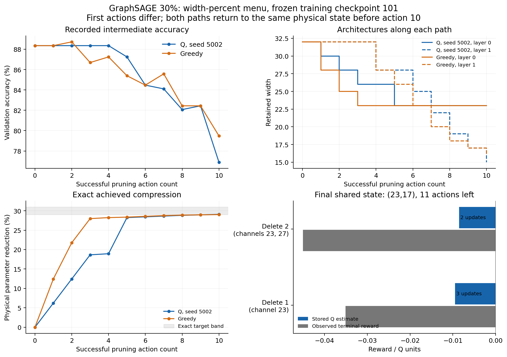
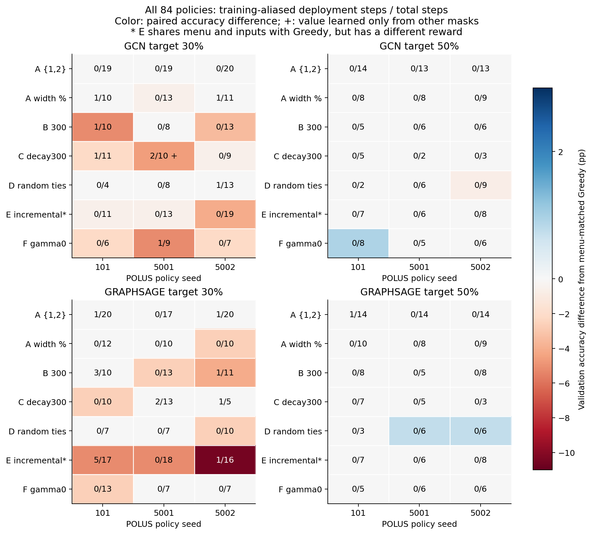

# V4 recorded policy decisions and trajectory consequences

**All 84 Q policies are reconstructed: 136,118 training decisions and 803 deployment decisions.** The illustrated GraphSAGE policy chooses an inferior observed terminal action because its finitely updated Q estimates rank the two actions in the reverse order from their recorded terminal rewards. State aliasing is widespread in training, but comparatively rare along these deployments; it is not needed to explain this final terminal choice.

This extends the [verified V4 report](../REPORT.md), reusing its final accuracy/F1, physical-model verification, provenance, cost accounting and controlled factor comparisons. No experiment, policy rollout, model evaluation, training, algorithm edit or test-label access was performed. Frozen scientific source remains `61e693440b53d3cac3136600f3208a73c02492db`; analysis starts at V4 branch commit `26632ab71beffd62955eca3b939139b9d9df367a`.

## Scope, controls and reproducible definitions

The units are individual **POLUS policies**, grouped by model, target, variant and policy seed. All three policy seeds share one frozen training checkpoint per model, training seed101. They are not independent trained GNNs. Local V3 seeds5001/5002 do not enter these trajectory pairs. The previous report's distinction between native POLUS101 single-factor controls and local developmental references still applies; this supplement does not manufacture missing native V3 policy replicates.

Each Q policy is paired with a deterministic **native POLUS Greedy** control with the same graph, split, checkpoint, model, target and action menu: the eight new V4 controls for the two alternative menus, and four verified V3 controls for the standard menu. Thus84 pairs share menus/inputs;72 also share the repeated-drop reward. E's12 pairs have a reward mismatch and are explicitly descriptive. No mismatched-menu pair is analyzed. Standard-menu inter-campaign cost ratios include instrumentation differences.

- **State:** exactly `('local_v2', (w0,w1), remaining_actions, floor(A_val/0.01), terminal)`. Layer numbers and original channel IDs are zero-based; deployment step numbers here are one-based. Widths, remaining horizon and the accuracy bucket are aggregate information; retained identities and exact within-bucket accuracy are absent from the key.
- **Legal actions:** width-dependent menu, minimum width4, exact compression band target±0.01 and feasible continuation within the remaining20-action horizon. The previous independent breadth-first reachability checker is reused. Percent sizes are `ceil(0.05*w)` and `ceil(0.10*w)`, deduplicated and ordered. Legal order is layer0 then layer1, ascending deletion size. No off-band STOP is available.
- **Known Q:** a state–action entry exists in the final training table, including an entry whose value equals zero. **Unseen:** no such entry; the implementation supplies0. This is an initialization prior, not a measured immediate reward or counterfactual accuracy.
- **Deployment selection:** epsilon0; choose the largest legal stored Q, using the first legal maximum in ordinary variants and a seeded random exact maximum in D. Every selected maximum, all alternative values, known flags and tie sets are preserved. The prior independent replay verifies training and deployment RNG decisions and Bellman updates against recorded observations, rather than executing policies again.
- **First divergence:** first different action in aligned dense-start prefixes; termination of one prefix also counts. First mask divergence compares the post-action original retained-ID lists separately. Later equal action counts do not imply equal physical models. Final mask equality compares both complete ordered ID sets, never widths alone.
- **Training aliasing:** within one run, a nonterminal key has at least two distinct before-action retained-ID signatures in training. Frequency counts both distinct keys and their decision observations. No keys are merged across policies. These are observed lower bounds on representational aliasing, not exhaustive enumeration of possible masks.
- **Reward conflict:** a training `(state,action)` has unequal recorded rewards. Both exact inequality and material span `>1e-10` are counted; repeated identical samples do not create additional pairs. The observation frequency counts all training samples belonging to conflicting pairs. Material within-mask variation is checked separately.
- **Deployment exposure:** a key was already aliased in training; this does not imply its selected action had conflicting rewards. **Cross-mask value transfer** is narrower: the selected entry exists, but training updated that entry only under masks different from the current mask. Training-only indexes avoid using deployment outcomes to define prior exposure.

Final accuracy/F1 in the tables are the previously verified native metrics. Intermediate accuracy uses archived float32 observations; no intermediate F1 was recorded. Compression is exact physical parameter reduction, not a zero-mask or channel fraction: `1-P/P_dense`, with GCN `P=1433a+ab+7b+a+b+7`, and GraphSAGE `P=2(1433a+ab+7b)+a+b+7`.

## All-policy decisions and matched endpoints

Of803 deployment decisions, **774 are unique known maxima**. The other29 select unseen0: nine unique maxima above negative known alternatives,11 first-in-order tied maxima, and nine randomly resolved tied maxima in D. All observed tied deployment winners are unseen0; none requires interpreting a tie between learned positive values. Twenty-nine such choices occur in15 runs; only two decisions are at wholly unseen state keys. The remainder have some training history at the state, but not for the selected action.

The following totals are descriptive counts across the four model–target cells and three policy seeds, not independent-model estimates. `Alias keys` and `conflict pairs` count within-run keys, summed across runs; conflicts use the material threshold. Mask matches use each run's menu control.

| Variant | Deployment steps | Unseen choices | Training alias keys | Training conflict pairs | Alias-exposed deployment steps | Final mask matches /12 |
|---|---:|---:|---:|---:|---:|---:|
| A {1,2} | 197 | 1 | 91 | 29 | 3 | 10 |
| A width % | 118 | 0 | 55 | 25 | 2 | 8 |
| B 300 | 103 | 0 | 241 | 58 | 5 | 8 |
| C decay300 | 83 | 0 | 218 | 65 | 6 | 8 |
| D random ties | 81 | 11 | 62 | 13 | 1 | 6 |
| E incremental* | 136 | 6 | 97 | 40 | 6 | 6 |
| F gamma0 | 85 | 11 | 73 | 15 | 1 | 7 |

*E shares menu/inputs with its Greedy reference, but not reward.*

**82/84 pairs diverge in action sequence:**66 at action1, nine at2, three at3, one at4 and three at5; two paths are identical throughout. Yet53/84 pairs end with exactly the same masks. Thus different paths often reconverge to the same final physical projection. Final width equality also occurs in53 pairs and, after explicit identity checks, coincides with mask equality in this particular archive. This coincidence is not a general inference rule. Conversely, six pairs have different widths/masks/compression while tying both accuracy and F1.

Final mask matches by model/target are GCN30:9/21, GCN50:16/21, GraphSAGE30:12/21, GraphSAGE50:16/21. Full per-seed widths, common channels, symmetric differences, exact compression, accuracy/F1 differences, evaluation counts and search costs are in [run_diagnostics.csv](run_diagnostics.csv). [summary.csv](summary.csv) has28 model–target–variant rows with seed vectors in101/5001/5002 order. No best policy seed is selected for an aggregate claim.

The earlier quality–cost conclusions remain: menu-{1,2} accuracy/F1 ties do not imply identical masks in all12 pairs;10 have identical masks and two have extra layer1 deletion at50%. Q's existing44–56× search cost for this menu buys no observed quality improvement. Gamma0 is a learned finite-visit table, not immediate Greedy:11/85 deployment decisions use unseen priors. B/C make186/186 choices from unique known maxima, yet some30% endpoints remain worse than Greedy. Deployment exploration is zero in every variant, including C; its schedule affects training observations and table values. D's nine tied deployment choices use the same feasibility filter; its extra training tie draws also alter later exploration draws through the shared RNG. E's poorer30% endpoints cannot be attributed to aliasing merely because E has training reward conflicts. Correct Q-ablation contrasts and reward/gamma rescorings remain in the [previous report](../REPORT.md) and [reward_and_exploration.csv](../reward_and_exploration.csv).

## Illustrated case: GraphSAGE30, width-percent Q, policy seed5002

**Selection is structural, not accuracy-based.** Among GraphSAGE30 runs, prefer new fully menu/reward-matched Greedy controls and require a different final mask; sort eligible cases by policy seed101,5001,5002, then declared menu order{1,2},percent. Only percent/5002 qualifies. This deliberately illustrative case is not a representative random sample, the worst observed run, or a new scientific winner selection.

Both methods start from the same94,279-parameter checkpoint. At action1, Q chooses layer0/delete2 whereas Greedy chooses layer0/delete4. Stored Q values at that common initial state are respectively0.122428 and0.021161; the other legal values are0.004438 for layer1/delete2 and0.008791 for layer1/delete4. Q therefore follows a unique known maximum. Greedy's recorded immediate reward is0.074613 versus Q's0.037306, with the same immediate accuracy88.355%. These are two observed outcomes from the common predecessor, not invented candidate scores.

All ten Q choices are unique known maxima. Each deployment key has one mask in its training observations; no selected entry was trained only under another mask. Other training keys in this run can still be aliased. The table gives the complete aggregate state via widths, remaining horizon `h` and accuracy bucket `b`; version=`local_v2`, terminal=false throughout before action. `Best other` is a stored Q estimate, not an immediate candidate score. Complete alternative values and identities are in [case_study.json](case_study.json) and [deployment_steps.csv](deployment_steps.csv).

| Step | Before widths; h; b | Layer:delete | Selected Q / best other Q |
|---|---|---|---|
| 1 | 32/32; 20; 88 | 0:2 | 0.122428 / 0.021161 |
| 2 | 30/32; 19; 88 | 0:2 | 0.096830 / 0.025917 |
| 3 | 28/32; 18; 88 | 0:2 | 0.067060 / 0.017621 |
| 4 | 26/32; 17; 88 | 1:4 | 0.032247 / 0.009100 |
| 5 | 26/28; 16; 88 | 0:3 | 0.031471 / 0.000936 |
| 6 | 23/28; 15; 87 | 1:3 | -0.025636 / -0.026130 |
| 7 | 23/25; 14; 84 | 1:3 | -0.020114 / -0.021968 |
| 8 | 23/22; 13; 84 | 1:3 | -0.015972 / -0.016635 |
| 9 | 23/19; 12; 82 | 1:2 | -0.010398 / -0.013311 |
| 10 | 23/17; 11; 82 | 1:2 | -0.008562 / -0.009513 |

Observed consequences after each Q choice:

| Step | After widths | Compression % | Val. accuracy % | Reward | Removed original IDs |
|---|---|---:|---:|---:|---|
| 1 | 30/32 | 6.2177 | 88.355 | +0.037306 | L0:4,8 |
| 2 | 28/32 | 12.4354 | 88.355 | +0.037306 | L0:3,31 |
| 3 | 26/32 | 18.6531 | 88.355 | +0.037306 | L0:2,10 |
| 4 | 26/28 | 18.9374 | 88.355 | +0.001706 | L1:4,13,19,21 |
| 5 | 23/28 | 28.2385 | 87.246 | +0.051370 | L0:1,6,7 |
| 6 | 23/25 | 28.4326 | 84.473 | -0.014362 | L1:20,25,30 |
| 7 | 23/22 | 28.6267 | 84.104 | -0.015841 | L1:1,6,14 |
| 8 | 23/19 | 28.8208 | 82.070 | -0.023974 | L1:0,10,11 |
| 9 | 23/17 | 28.9502 | 82.440 | -0.022883 | L1:5,24 |
| 10 | 23/15 | 29.0796 | 76.895 | -0.045065 | L1:23,27 |



Figure1. Both paths have ten actions. Connecting observations by action count does not equate their intermediate states. Before action10 they **do** have the same retained IDs, widths23/17, accuracy82.440%, horizon11 and bucket82. The final panel compares stored Q estimates with recorded terminal rewards at that shared physical predecessor; it does not fill in unobserved alternatives elsewhere.

At that last state, the legal percent menu is{1,2}. Both choices terminate in band, with bootstrap0. The preserved [five training updates](case_terminal_updates.csv) show:

| Action | Training episodes (zero-based) | Constant recorded reward r | Updates n | Final Q = r(1−0.9^n) |
|---|---|---:|---:|---:|
| L1/delete1 | 43,56,73 | -0.035101612 | 3 | -0.009512537 |
| L1/delete2 | 21,86 | -0.045064607 | 2 | -0.008562275 |

With initialization0 and alpha0.1, unequal finite update counts leave delete2's estimate closer to0, reversing the observed terminal-reward ranking. Q chooses delete2 exactly as implemented. This numerical mechanism needs neither aliasing, a tie, an unseen action, nor future credit at this state. It does **not** predict what additional episodes or another hyperparameter would have done.

Greedy's recorded delete1 removes channel23; Q's delete2 removes23 and27. Final layer0 IDs coincide; final layer1 masks differ only by27. Q ends at23/15,66,863 parameters,29.07965% compression; Greedy at23/16,66,924 parameters,29.01495%. Final accuracy/F1 are76.89464%/68.64253% versus79.48244%/72.87447%: differences−2.58780pp/−4.23194pp. Search costs are35.0212s/1,222 evaluations versus0.7187s/26 evaluations, a48.73× observed search ratio. The smaller final Q model has61 fewer parameters; neither these counts nor the search ratio measure inference latency.

## State aliasing, reward conflicts and deployment associations

Across29,250 observed nonterminal training keys, **837 keys are aliased in82/84 policies** (2.86% of within-run keys). Their5,705 observations represent4.19% of136,118 training decisions. Of44,474 observed training state–action pairs,667 have multiple masks. **247 pairs have exact reward variation;245 have material variation**, in60 runs. The latter pairs contain880 observations (0.65% of training decisions); all245 have multiple masks, and there are **zero material within-mask conflicts**. The two exact-only conflicts are below the declared tolerance. The previous combined training/deployment counts also total837 aliased keys and247 exact conflicts, so the training-only definition happens to reproduce those totals here.

These observations are consistent with aggregate keys combining physically different models, but do not isolate mask omission from other omitted information, such as exact within-bucket accuracy. They are not evidence that every aliased key has contradictory rewards or that such contradictions caused a final-quality loss.

Only **24/803 deployment steps (2.99%) in16/84 runs** visit keys already aliased in training. No deployment encounters a previously unobserved mask at an already observed key; the two wholly unseen keys are a separate category. Selected-action reward conflicts are exposed at just two steps,11 and13, of GraphSAGE30/E/101. Its final23/9 model is5.18pp accuracy/11.83pp F1 below its menu-only Greedy reference, but the reward mismatch and different architecture prohibit attributing that difference to aliasing.

Exactly **one chosen Q entry is supported only by other masks**: GCN30/C/5001, step10, state `(23,20),h=11,b=87`, action layer1/delete8. Training observed two masks at the state, but updated that action only under the other mask. The final model is23/12,4.62pp accuracy/10.10pp F1 below matched Greedy. This is observed cross-mask value transfer and an associated poorer endpoint, not an isolated causal effect. Other C policies and many poorer endpoints have no such transfer.

For the72 reward/menu/input-matched pairs only, the following are descriptive run counts, with no independence assumption, hypothesis test or pooled treatment estimate:

| Deployment visits a training-aliased key | Runs | Accuracy higher / equal / lower than matched Greedy |
|---|---:|---|
| Yes | 14 | 0 / 9 / 5 |
| No | 58 | 3 / 44 / 11 |

Quality loss also occurs without exposure, and exposure often coexists with equal quality. Absence of direct deployment exposure does not exclude indirect effects through training bootstrap values. The strata differ in menus, targets and trajectory length; these counts cannot establish an aliasing effect. The per-condition/per-seed figure retains those strata rather than fitting a cross-run causal regression.



Figure2. Each cell is one POLUS policy on the shared checkpoint. Text gives training-aliased deployment steps/total; color gives its accuracy difference from menu-matched Greedy. `+` marks the single cross-mask selected-value transfer. E has a reward mismatch. No seed is a new trained checkpoint. Aliasing is not required for a poorer endpoint; the illustrated percent/5002 cell has0/10 exposure.

**Observed:** exact argmax/tie decisions, visit/update histories, identities, trajectory consequences, conflicts and matched endpoint/cost differences. **Hypotheses only:** aliasing or uneven exploration may contribute to other policy errors; greater coverage or alternative representation might change them. **Unobservable here:** unrecorded candidate rewards/accuracies, Greedy's margins over every rejected candidate, alternative policies from snapshots, results of additional episodes, or final test performance. Greedy's source uses immediate-reward maximization, but its full candidate scores were not archived; they are not reconstructed by inference. A Q estimate is never relabelled as such a score.

## Files, verification and reproduction

- [deployment_steps.csv](deployment_steps.csv):803 rows, every pre-state, ordered legal Q values, per-action known flags and training support/reward ranges, exact maxima, selection reason, before/after IDs, removals, widths, recorded accuracy/reward, compression/counts and stopping. Terminal penalties remain zero;81 policies stop at `target_band`, three menu12 policies at max_steps20 while in band. This is feasibility-controlled stopping, not evidence of a learned independent STOP policy.
- [run_diagnostics.csv](run_diagnostics.csv):84 per-seed joins to the earlier verified runs, alias/conflict frequencies and exposures, matched Greedy endpoints, retained-ID differences, divergence, costs and quality differences. [summary.csv](summary.csv):28 condition/variant rows retaining seed vectors.
- [deployment_alias_states.csv](deployment_alias_states.csv) and [deployment_reward_conflicts.csv](deployment_reward_conflicts.csv): training identity counts and reward ranges for deployment-relevant keys. Complete training indexes remain external; no raw traces/checkpoints are copied into Git.
- [verification.json](verification.json): archive/inventory hashes, original92 output sets plus four historical Greedy sets checked against prior completion anchors,84 Q/RNG/update/snapshot replays, earlier-analysis hashes, external-index hashes. [manifest.json](manifest.json) binds all compact outputs, tools and test evidence.

All1,285 original inventory files and archive hash `d80ea49be02c5e08ec7169a323b91c368875e4b42fab5dbeffb655ffca468704` remain unchanged. The earlier verified final models/metrics are reused, not reevaluated. Eleven diagnostic tests pass, including rejection of changed/nonmaximal Q values, tie order, known-zero distinction, training-only aliasing, tolerance, width-vs-mask divergence, complete84-policy joins and the illustrated terminal-update identity. Both figures were visually reviewed. Changes are confined to this new subdirectory; previous analyses, algorithms, raw evidence and SITITO manuscript are preserved.

Run from repository root using the existing validation Python3.12/Torch environment; `analyze.py` imports the prior auditor solely to replay recorded arithmetic and RNG, never its model-evaluation entry point. Use a fresh external output directory:

```bash
PYTHONPATH=src PYTHONDONTWRITEBYTECODE=1 python \
  research/experiments/polus_v4_diagnostic_20261029/results/policy_trajectories/tools/analyze.py \
  --collection "$GNN_ARTIFACT_ROOT/polus-v4-collection-20261029T111126Z" \
  --external /path/to/fresh-external-trajectory-index
PYTHONPATH=src PYTHONDONTWRITEBYTECODE=1 python \
  research/experiments/polus_v4_diagnostic_20261029/results/policy_trajectories/tools/test_analysis.py -v
```

`tools/plot.py` reads only these derived outputs using the existing Python3.8/Matplotlib3.7.5 environment. `tools/package.py` verifies compact cross-file accounting and prior hashes, then writes the manifest. The external final indexes and replay/test logs are under `${GNN_ARTIFACT_ROOT}/polus-v4-trajectories-20261029T144000Z/`; their exact hashes are recorded. No inference-latency benchmark or test-based tuning supports an additional scientific claim.
